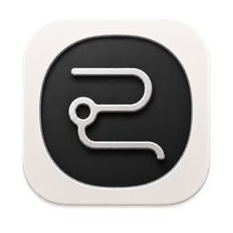
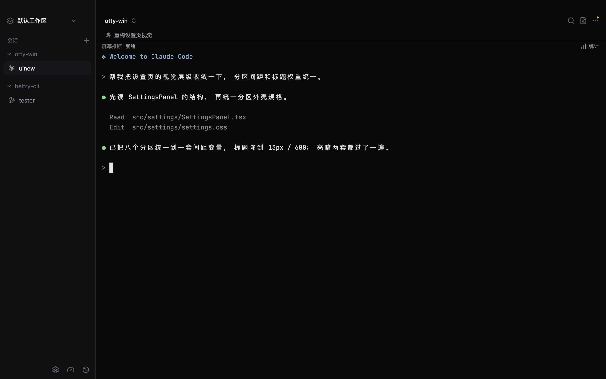
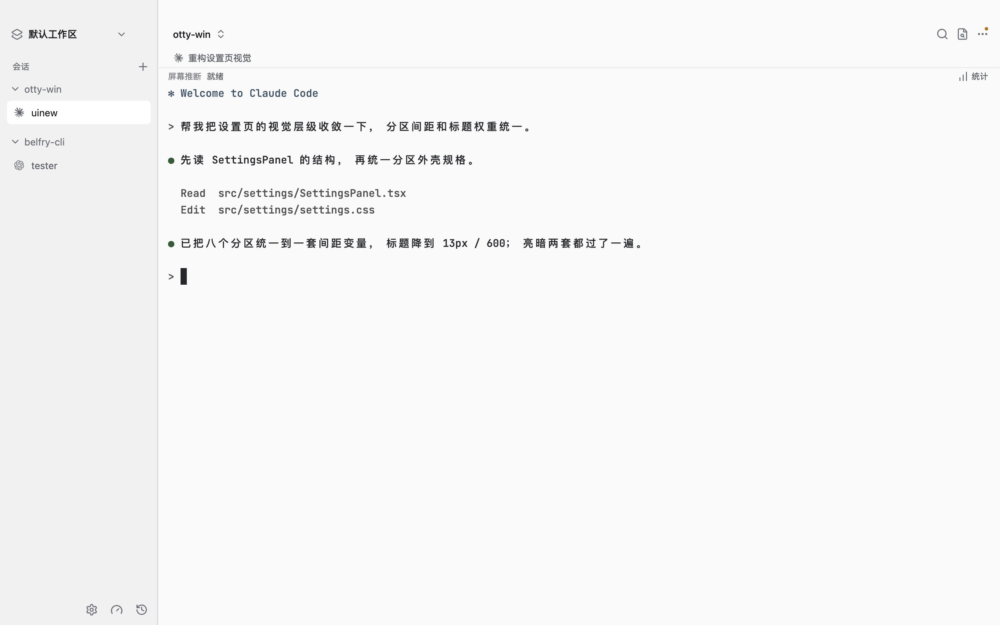
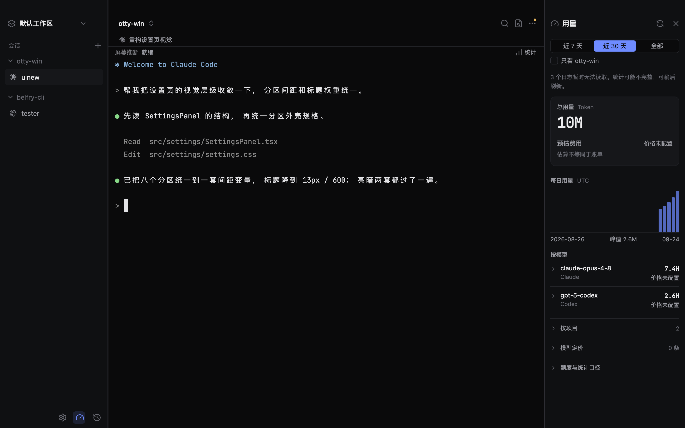
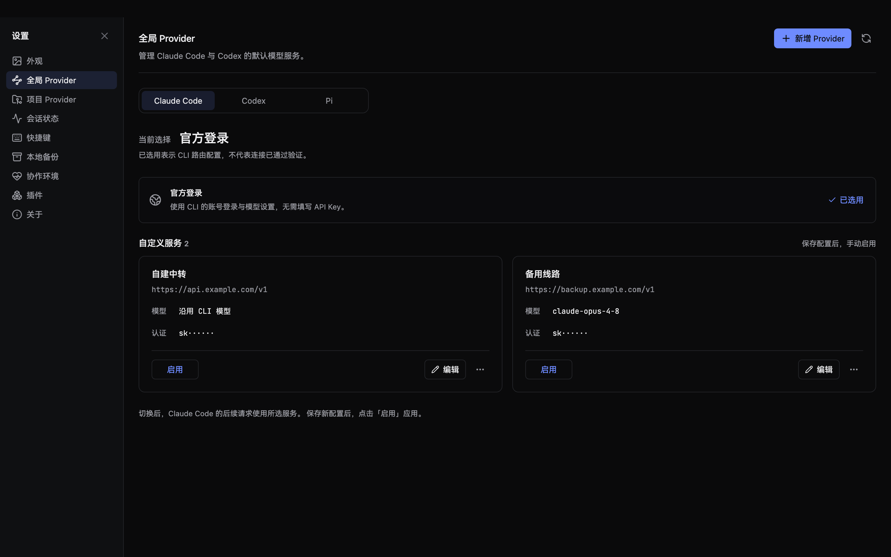
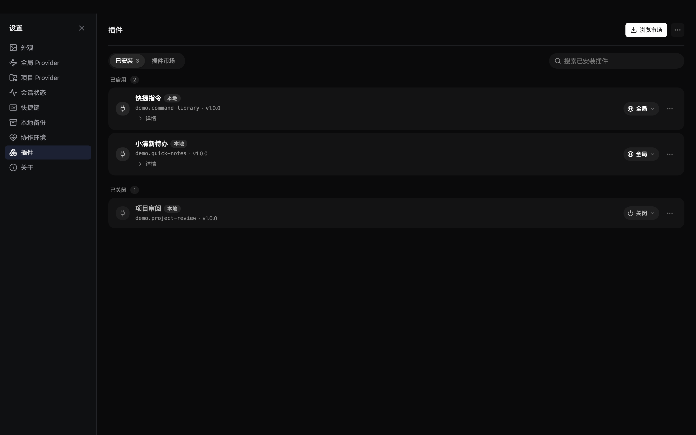

<div align="center">



# Belfry

---

### Hosts your CLI agents. Still a real terminal.

Run Codex, Claude Code, Pi, Antigravity CLI, OpenCode, and Kimi Code through one interface on macOS and Windows, and see what they're doing — working, waiting on you, or done. No agent installed? It's still a full terminal.

**English** · [简体中文](README.md)

[](https://chengsoon.github.io/belfry-desktop/en/)
[](https://github.com/ChengSoon/belfry-desktop)
[](https://github.com/ChengSoon/belfry-desktop/releases)
[](LICENSE)
[](#download)
[](https://tauri.app)
[](https://github.com/ChengSoon/belfry-desktop/stargazers)

[Download](#download) · [Get started](#get-started) · [Features](#features) · [UI](#ui) · [Principles](#principles) · [Development](#development) · [Roadmap](#roadmap) · [License](#license)

<br/>



</div>

> [!WARNING]
> **Under active development.** The app includes local workspaces, background terminals, session collaboration, history and usage, and an optional PI plugin system. See the [implementation record](docs/cli-manager-implementation.md) for outstanding native and Windows acceptance work. Interfaces and data formats may still change.

## Download

Installers live on the [Releases](https://github.com/ChengSoon/belfry-desktop/releases) page. Three build targets are available: macOS Apple Silicon (`aarch64`), macOS Intel (`x64`), and Windows.

The macOS builds are ad-hoc signed but not notarized by Apple. The Windows builds are unsigned:

- On macOS, if Gatekeeper blocks the first launch, right-click the app in Finder and choose Open, or allow it under System Settings → Privacy & Security.
- On Windows, SmartScreen flags an unknown publisher — choose More info → Run anyway.

Minimum versions: macOS 14, Windows 10 22H2 (Build 19045) / Windows 11.

## Get started

Belfry ships no agents of its own — it hosts the ones already on your machine. So first make sure at least one works:

```bash
codex --version
claude --version
```

Then:

1. Launch Belfry, click the project switcher at the top, pick a local directory.
2. Open the new-session menu in the sidebar and choose Shell, SSH, or one of six agents. Undetected agents are greyed out; hover to see why, or install them from About.
3. Open as many sessions per project as you want — tabs name themselves after your first prompt.
4. Hit `⌘U` for the usage panel to see which model and project your tokens went to.

Neither agent detected? Doesn't matter. Shell sessions don't depend on them, and Belfry is just a terminal at that point.

## Features

**Project workspace**

- Open a local directory as a project; recents are remembered
- Sidebar groups by project, folds, and has a draggable width (`⌘B` collapses it entirely)
- Each session carries its own project, so different sessions can point at different directories
- Named workspaces preserve session groups, split layouts and active focus; reopening restores background session identities
- Quick Open (`⌘K`) searches sessions and recent projects, and runs common workspace actions
- The file preview pane browses the active project, opens read-only code previews, follows file paths from terminal output, and surfaces disk-change notices
- Git Diff supports line feedback: select a change, write a comment, and send it to an Agent in the current project; changes are checked before sending, busy sessions queue feedback, and unsent feedback can be cancelled

**Agent hosting**

- Detects all six agents automatically: executable path, version, and a reason when unavailable; supports installation and updates
- Antigravity CLI, OpenCode, and Kimi Code support native history, usage, providers, plugins, queues, and collaboration. See the [integration notes](docs/native-agent-integration.md) for tested versions and native differences
- Session state separates process lifecycle (creating / running / exited / error) from current behavior (idle / talking / awaiting choice)
- Tab titles are extracted from your first prompt; the untruncated original stays in the tooltip
- Tasks, discussions, and replies share each Agent's [collaboration inbox](docs/collaboration-inbox.md), with original messages and waiting reasons visible; messages dispatch by topic when idle, while new tasks wait for the previous task to finish
- Room members can [choose a model per role](docs/room-role-models.md) for the next launch, or clear the override to use the default

**Activity notifications**

- Only two things are worth interrupting you for: the agent finished, or it's stuck on something only you can answer
- Completion notifications wait 1500 ms before firing. Activity is inferred by scanning screen text, and `talking → idle → awaiting choice` is a common path (the spinner disappears a beat before the permission prompt paints) — firing "finished" in that gap is a pure false positive
- Nothing pops while you're looking right at that session — you've already seen it
- State goes in the title, identity in the body: first decide whether to deal with it now, then which session it was
- Unread counts aggregate into the Dock / taskbar badge and clear when you come back

**Provider switching**

- Global and project providers are available for all six agents. Global selections use native CLI configuration; Antigravity's Gemini endpoint and key are injected when Belfry launches it
- Surgical field rewrites: only routing keys like `ANTHROPIC_BASE_URL` and the `[model_providers.belfry]` table are touched — your hooks, MCP definitions, and project trust records stay byte-for-byte intact
- On first launch, whatever is already in your config files is adopted as a switchable entry, so nothing is silently overwritten
- Codex's ChatGPT login state is backed up before switching to a third party and restored verbatim when you switch back
- Detects `ANTHROPIC_*` / `OPENAI_*` environment variables that would override the config file, and says so

**Terminal**

- xterm.js with the WebGL renderer — no seams between block characters
- Unix PTY on macOS, ConPTY on Windows; shell resolution tries PowerShell, `%ComSpec%`, then `cmd.exe`
- SSH sessions spawn the system OpenSSH client: passwords, host-key fingerprints, and 2FA are handled interactively in the terminal, and `~/.ssh/config` aliases, keys, and agent inherit as-is
  - Check "remember password" when connecting to store it in the OS keychain (macOS Keychain / Windows Credential Manager) and auto-fill future connections; saved passwords can be cleared from the SSH form
- OSC 10/11 color queries are answered in Rust. This isn't optional: TUIs like Codex allow a ~100 ms window, and a round trip through `PTY → IPC → xterm.js → IPC → PTY` frequently misses it. On Windows the cost of a timeout isn't "no color" but "wrong color" — Codex falls back to ConPTY's black palette and paints the input box as a black block.
- Password prompt detection, with echo suppressed
- `⌘F` searches terminal content across wrapped lines; HTTP(S) URLs are clickable; CJK, combining characters, and emoji use correct cell widths

**Usage stats**

- Aggregated from local CLI data, including the three new agents' native stores — no network requests
- Four token buckets on one scale: input (excluding cache hits), cachedInput, cacheWrite, output
- Broken down by model and by project; window selectable as last 7 days / last 30 days / all time
- Quota windows and plan type (only Codex logs carry these fields; Claude's don't)

**Optional plugins**

- Install `.piplug` packages, load development directories, or choose plugins from a marketplace
- Panels, commands, Agent tools, Skills, settings and themes; executable plugins require local Node.js 20 or newer
- Templates, validation, packaging and a local personal marketplace, with independent online catalogs also supported
- See the [PI plugin guide](docs/plugins/pi-runtime-guide.md) and [personal marketplace guide](docs/plugins/own-market-guide.md) for capabilities and permissions

**Appearance**

- Light/dark theme, with theme colors fed through to the terminal palette
- Synchronized app-wide font and 10–20px sizing, with locally installed font support
- Multiple persistent TTF / OTF / WOFF / WOFF2 imports, each independently selectable and removable, with instant switching back to system fonts
- JetBrains Mono and HarmonyOS Sans SC bundled

Belfry shortcuts: `⌘T` opens a Shell, `⌘B` toggles the sidebar, `⌘K` opens Quick Open, `⌘U` toggles usage,
`⌘⇧H` toggles history, `⌘,` opens settings, `⌘1–9` switches sessions, and `⌘/` opens
the shortcut guide. Windows uses `Ctrl+Shift` chords so Codex and Claude keep
their native `Ctrl` shortcuts.

## UI

**Workspace** (see the banner above) — sessions grouped by project in the sidebar, tabs named after your first line; hosted Codex / Claude Code run right in the terminal. Below: light theme, usage, provider switching, and the plugin center.

<table>
  <tr>
    <td width="50%"></td>
    <td width="50%"></td>
  </tr>
  <tr>
    <td><sub><b>Light theme</b> · light/dark toggle, theme color fed into the terminal palette</sub></td>
    <td><sub><b>Usage panel</b> (<code>⌘U</code>) · aggregated from local logs, split by model / project</sub></td>
  </tr>
  <tr>
    <td></td>
    <td></td>
  </tr>
  <tr>
    <td><sub><b>Provider switching</b> · rewrites the CLI's own routing config, toggling between official and third-party relays</sub></td>
    <td><sub><b>Plugin center</b> · install <code>.piplug</code>, load a dev directory, or browse the market</sub></td>
  </tr>
</table>

> Screenshots use sample data; the UI is the real frontend rendered.

## Principles

**CLI requests are sent by the Agent.** Provider switching updates the CLI's own routing configuration, with API keys stored locally as the CLI expects. Optional plugins can call configured services through the host model API; the plugin guide documents those capabilities and permissions. The main interface remains focused on terminals and sessions.

**Full degradation to a plain terminal when agents are unavailable.** Agent integration is an enhancement, not a prerequisite. Failed detection should never stop you from opening a shell.

**Shared UI and core; branch on capability, not on OS name.** Platform differences are confined to adapters — no `if (windows)` in business code.

**Pixel parity across platforms is a non-goal.** Menus, shortcuts, and window behavior follow each platform's conventions.

The product is a local terminal and CLI Agent workspace for macOS and Windows. It does not currently provide iOS / Android / web builds, cloud sync, accounts, cloud team collaboration, LSP or debuggers, and never elevates privileges silently.

## Stack

| Layer | Choice |
| --- | --- |
| Desktop shell | Tauri 2 |
| Backend | Rust 2024 edition (rustc 1.85+), portable-pty |
| Frontend | React 19, TypeScript, Vite |
| Terminal | xterm.js 6 + WebGL addon |

## Development

Requires [Rust stable](https://rustup.rs), Node.js LTS, and pnpm 10.34.4 as pinned in `package.json`.
Native development also needs the [Tauri platform prerequisites](https://v2.tauri.app/start/prerequisites/), including MSVC and the Windows SDK on Windows.

Run from the repository root:

```bash
pnpm install --frozen-lockfile
pnpm desktop:dev      # desktop dev; prepares the control CLI sidecar
pnpm desktop:build    # native bundle; builds frontend and target CLI sidecar
pnpm test             # frontend unit and model regression
pnpm build            # type check and frontend production build
```

Rust and plugin regression also run from the repository root:

```bash
node scripts/bundle-cli.mjs
cargo test --manifest-path src-tauri/Cargo.toml --workspace --locked
pnpm build
node .github/workflows/verify-plugins.mjs
node --test .github/workflows/release-assets.case.mjs scripts/bundle-cli.case.mjs
```

`bundle-cli.mjs` prepares a real host CLI for Tauri's `externalBin` with `cargo build --locked`;
an outdated lock fails preparation without being updated. Sidecar tests verify this in an isolated, offline temporary Cargo workspace.
Plugin regression requires Chrome, Chromium or Edge;
set `BELFRY_BROWSER_EXECUTABLE` to an absolute path if needed. Tests use temporary browser instances and fail if no browser is available.
The runner also serves `dist` directly to test production panel JS, CSS and shared dependency failures while preserving terminals.
Run `pnpm build` first; a missing production build fails the checks. To run only these cases:
`node --test src/components/lazy/testing/production-panels.case.mjs`.
Four original PI interoperability cases additionally need `BELFRY_PI_SOURCE` pointing to upstream commit
`4fb58d36f4b0f05e4527d8bdf2da874e31933134`, plus `market-fixtures/pi.gitlens`, `pi.log-viewer` and `pi.todo`.
Without those fixtures the runner explicitly reports that acceptance gap; it does not count those cases as passed.
Run `./scripts/test-windows-installer.ps1` in PowerShell for the Windows installer script regression.

[PR/branch checks](.github/workflows/checks.yml) configure these regressions on macOS and Windows, then reuse the build
for targeted release asset, sidecar lock and production panel tests under Node 20.
The [release workflow](.github/workflows/release.yml) reuses the checks, builds three targets, and publishes the draft
only after all platform installers, signatures and `latest.json` are present. Manual reruns must select an existing
`v*` tag matching the app version. A configured workflow is not evidence of native Windows or remote release acceptance.

### Layout

```
src/                  frontend
  workspace/          project workspace, tabs, sidebar
  terminal/           PTY sessions and xterm control
  prompt/             background collaboration delivery queues per Agent
  quickopen/          fast search across sessions, projects, and actions
  provider/           provider switching for the agent CLIs
  settings/           settings (appearance, providers, Hooks, backup, plugins)
  plugins/            plugin center, runtime bridge and workspace views
  history/            local history search and resume
  git/                Git inspection and guarded Worktree operations
  notify/             activity notifications and badge
  usage/              token usage aggregation and display
  panel/              panel width and dragging
  shortcuts/          global shortcuts and shortcut guide
  theme/              theming and terminal palette
  typography/         global font, sizing, and imported assets
src-tauri/src/        Rust backend
  project/            project directories and recents
  agent/              Codex / Claude detection
  provider/           surgical rewrites of both CLIs' config files
  terminal/           PTY backend, launch profiles, OSC replies
  usage/              Codex / Claude session log parsing
  plugins/            plugin management, Node host and MCP integration
scripts/              CLI bundling and native/plugin regression scripts
docs/                 design, implementation and acceptance records
.github/workflows/    PR checks and draft release pipeline
```

Start with the [CLI implementation record](docs/cli-manager-implementation.md) and [PI plugin guide](docs/plugins/pi-runtime-guide.md). Step-by-step plans live in `docs/superpowers/plans/`.

## Roadmap

See the [CLI feature backlog](docs/cli-manager-feature-backlog.md) and [implementation record](docs/cli-manager-implementation.md) for planned work and acceptance status. The version entries below retain their historical context:

### Shipped versions

- **v0.10.0 · Terminal foundation**: cross-platform Shell Profiles, terminal search, clickable HTTP(S) links, Unicode width support, and backwards-compatible workspace archives.
- **v0.11.0 · Workspace navigation**: Quick Open search across sessions, projects, and actions, with keyboard navigation and common workspace commands.
- **v0.12.0 · Prompt Composer & Queue**: introduced per-session queues, idle dispatch and recovery across target remounts. The dedicated Composer and Recipe panels have since been removed; background queues continue to serve session collaboration.
- **v0.13.0 · File Preview Pane**: browse the project tree, open size-limited read-only text previews, jump from terminal paths, add lightweight syntax highlighting, protect binary files, and surface external changes.
- **v0.14.0 · Agent adapter foundation**: unify Codex / Claude detection, launch, state, history, and resume behind one adapter layer, with explicit session identity validation, safe resume planning, and a responsive two-column shortcut guide.
- **v0.15.0 · Session collaboration**: give Agent sessions stable names, delegate and settle work between same-project sessions with the bundled `belfry` CLI, and track approvals, safety limits, queued delivery, and task state in the collaboration panel.
- **v0.16.0 · Collaboration setup**: diagnose the Belfry skill, Codex login and feature state, doctor results, and the collaboration channel from Settings, with automatic synchronization and manual updates for the bundled skill.
- **v0.17.0 · Multi-client collaboration setup**: extend collaboration diagnostics and bundled skill synchronization to both Codex and Claude Code, report each client independently, and preserve partial-success results.
- **v0.18.0 · Collaboration timeline**: add an event timeline, task waiting times, and prominent completion results and failure reasons to the collaboration panel.
- **v0.19.0 · Terminal readability**: improve contrast and font weight in light terminals, with separate background underlay preferences for light and dark themes.
- **v0.20.x · Plugin ecosystem**: add the plugin center and PI plugin marketplace, dynamic tool discovery, and todo synchronization; bundle real JetBrains Mono weights on Windows. Remove the dedicated Prompt Composer and Recipe panels while retaining background queues.
- **v0.21.x · Workspace & Agent tools**: background terminals, named workspaces, Agent Hooks, full-text history search, project Providers, Git Worktrees, SSH profiles, backups, and usage trends; add Pi CLI, installation and update tools, bilingual documentation, credential encryption, and improved background recovery.
- **v0.22.0 · Collaboration rooms**: introduce project rooms with an embedded member terminal viewer, separate windows, and session context controls.
- **v0.23.0 · Coordinator & shared task board**: organize rooms around a coordinator and members, with a brief, shared T-number tasks and dependencies, pending replies, a flow graph, file sharing, and user notifications; provide the `room status / say / log / task / brief` commands.
- **v0.24.0 · Six Agent clients**: add Antigravity CLI, OpenCode, and Kimi Code alongside Codex, Claude Code, and Pi, integrating native history, usage, Providers, plugins, and room collaboration, with room protocol compatibility for older background services.

### v0.25.0 · Reliability & bilingual app

- **Collaboration reliability**: fix room switching, drafts, operation errors, and read status; persist tasks and pending deliveries, distinguish queues from terminal submission, and offer manual checks for uncertain delivery; retain early pending replies and add history pagination, capacity display, and startup from snapshots.
- **Plugins and CLI**: preserve existing settings when a save exceeds the size limit, clean up descendant processes after plugin timeouts or cancellation, and enforce a deadline for `wait --timeout` even when the service does not respond.
- **Logs and diagnostics**: rotate local logs daily with a total size limit, record crashes, export redacted diagnostics, and offer diagnostic copying and reload controls on the crash screen.
- **Content Security Policy (CSP)**: restrict application content sources and verify terminal, WebGL, plugin panel, media, and web preview functionality.
- **Internationalization**: support Simplified Chinese, English, and the system language, with localized dates and numbers; provide bilingual CLI help, native notifications and menus, Agent collaboration instructions, and the Windows installer.
- **Release checksums**: publish `SHA256SUMS.txt`, verify assets before making the release public, and document verification on Windows and macOS.

### v1.0.2 · Claude choice state fix

- Fixes rooms continuing to show "Awaiting your choice" and blocking later collaboration messages after a Claude Code question has been answered. The session resumes processing and becomes idle when the turn ends; other pending requests retain their own state. Restart the background service and reopen Agent sessions after upgrading.

### v1.0.1 · Claude delivery fix

- Fix collaboration messages remaining queued when Claude Code has an empty input with a permission-mode footer; drafts, attachments, and selection prompts still block delivery.

### v1.0.0 · Room inbox & role models

- **Room inbox**: an Inbox tab beside Chat and Flow shows each member session's tasks, discussions, per-question replies and delivery status; read-only, reading never triggers delivery.
- **Durable automatic delivery**: messages are collected while members are busy or offline and submitted per topic once the session is ready; user input wins, and uncertain results are never re-pasted.
- **Per-role models**: set a model for a single role, fetch the provider's model list to choose from; applies on the role's next launch.

### v0.26.0 · Room projects & terminal requests

- **Room project selection**: choose and validate a project directory when creating a room; member terminals start in that directory.
- **Terminal request panel**: view questions, context, and options at the top of a room and answer single-choice, confirmation, multiple-choice, and text requests; retain drafts, revalidate requests before submission, and open the terminal for unknown formats.
- **Room layout and stability**: keep chat and sending controls accessible in small windows, contain long briefs, and preserve flow nodes during activity updates; improve browser startup diagnostics and cross-platform checks.

### Long-term tracks

- **Shared UI** — split panes, settings, quick open, file preview panes (v0.13)
- **Shared Core** — session persistence and restore, agent adapter foundation, history and resume, collaboration delivery, import/export
- **Terminal Runtime** — cross-platform shell profiles (zsh/bash/fish, PowerShell/CMD/WSL/Git Bash), SSH
- **Platform Services** — notifications, Dock / Taskbar, credentials (Keychain / Credential Manager), global shortcuts, control CLI
- **Content & Git** — file editing and Git integration
- **Distribution** — signing, notarization, installers, auto-update

## Contributing

Issues and PRs welcome. Opening an issue first to align on direction is a good idea — interfaces shift often at this stage, and it saves wasted work.

Before opening a PR, run the frontend, Rust workspace and Node plugin commands above, and report any missing native or upstream acceptance environment.

## Disclaimer

Belfry is a hosting layer for terminals and sessions. It is not responsible for what an agent executes on your machine. An agent's privileges are your shell's privileges: give it the ability to read and write files, run builds, and install dependencies, and it has the ability to delete things it shouldn't. Use it in version-controlled directories and review consequential operations yourself.

Numbers in the usage panel come from logs the agents write locally. Treat them as an estimate, not a bill — your provider's console is authoritative.

## License

[LGPL-3.0](LICENSE). LGPL-3.0 is a set of additional permissions on top of GPL-3.0; the complete terms require reading [GPL-3.0](LICENSE.GPL-3.0) alongside it.

Bundled fonts carry their own licenses: [JetBrains Mono](public/fonts/LICENSE-JetBrains-Mono.txt) (SIL OFL 1.1) and [HarmonyOS Sans](public/fonts/LICENSE-HarmonyOS-Sans.txt).

## Links

- [LINUX DO](https://linux.do/) — developer community
