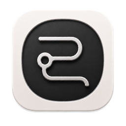
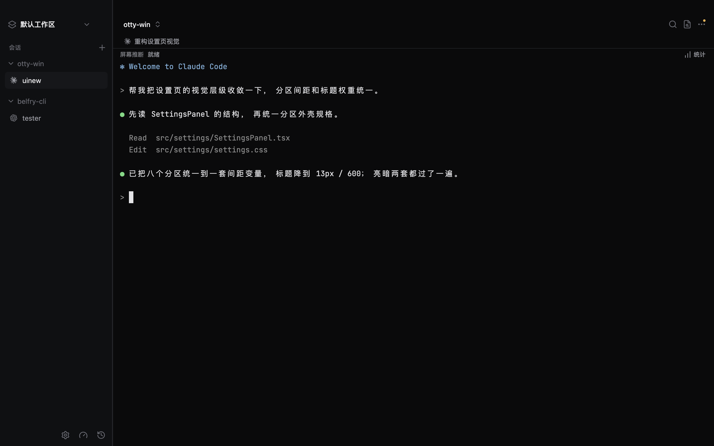
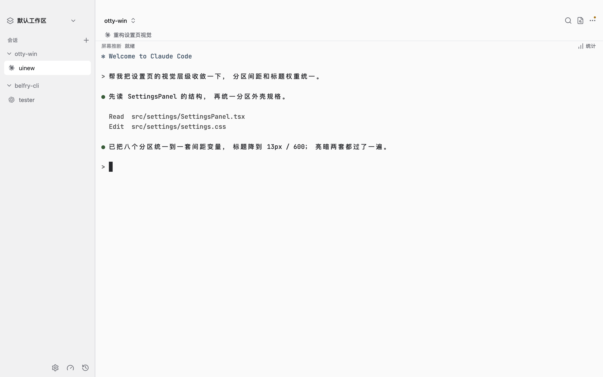
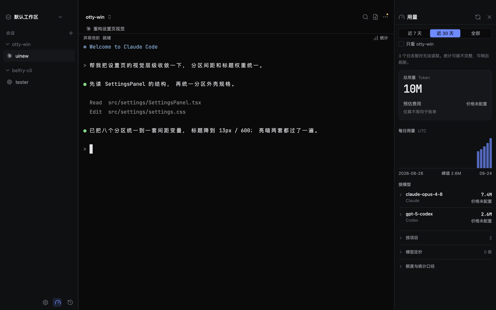
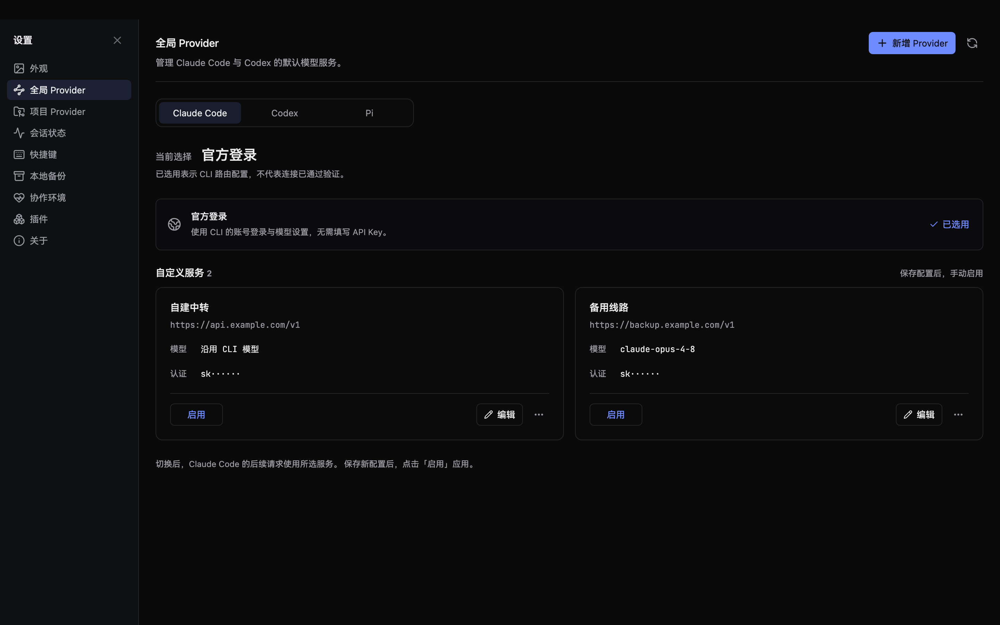
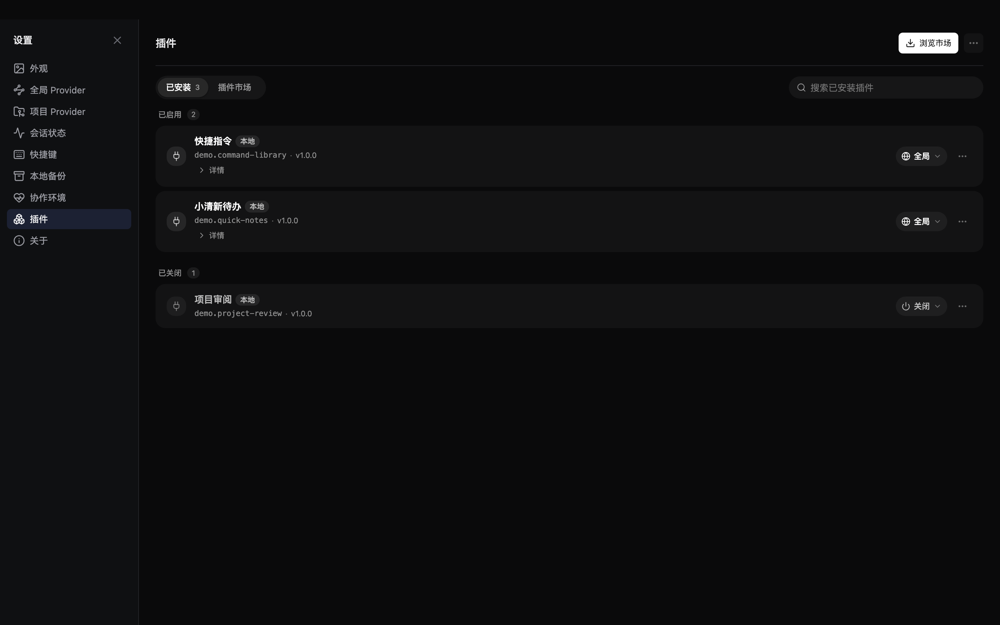

<div align="center">



# Belfry

---

### 托管你的 CLI Agent，也是一把称手的终端。

在 macOS 和 Windows 上用同一套界面跑 Codex、Claude Code、Pi、Antigravity CLI、OpenCode 和 Kimi Code，顺带看清它们在忙什么、在等谁。Agent 不在，它照样是完整终端。

[English](README.en.md) · **简体中文**

[](https://chengsoon.github.io/belfry-desktop/)
[](https://github.com/ChengSoon/belfry-desktop)
[](https://github.com/ChengSoon/belfry-desktop/releases)
[](LICENSE)
[](#下载)
[](https://tauri.app)
[](https://github.com/ChengSoon/belfry-desktop/stargazers)

[文档](https://chengsoon.github.io/belfry-desktop/) · [下载](#下载) · [快速开始](#快速开始) · [功能](#功能) · [界面](#界面) · [设计取向](#设计取向) · [开发](#开发) · [路线图](#路线图) · [许可证](#许可证)

<br/>



</div>

## 下载

安装包在 [Releases](https://github.com/ChengSoon/belfry-desktop/releases) 页面，三个构建目标：macOS Apple Silicon (`aarch64`)、macOS Intel (`x64`) 和 Windows。

macOS 产物使用 ad-hoc 签名但未经过 Apple 公证，Windows 产物未签名：

- macOS 首次打开若被 Gatekeeper 拦截，请在 Finder 中右键应用选择「打开」，或去「系统设置 → 隐私与安全性」里放行。
- Windows 上 SmartScreen 会报「未知发布者」，选「更多信息 → 仍要运行」。

最低系统版本：macOS 14，Windows 10 22H2 (Build 19045) / Windows 11。

## 快速开始

Belfry 不自带 Agent，它托管你机器上已经装好的那些。所以先确认至少有一个能用：

```bash
codex --version
claude --version
```

然后：

1. 启动 Belfry，点顶部的项目选择器，选一个本地目录。
2. 侧栏的新会话菜单里挑 Shell、SSH 或六种 Agent。检测不到的 Agent 会标灰，鼠标悬停能看到原因；可到「关于」页安装。
3. 同一个项目下可以并排开多个会话，标签自己按你输入的第一句话命名。
4. `⌘U` 打开用量面板，看 token 花在哪个模型、哪个项目上。

两个 Agent 都没检测到也无妨——Shell 会话不依赖它们，Belfry 此时就是个普通终端。

## 功能

**项目工作区**

- 打开本地目录作为项目，记住最近打开过的
- 侧栏按项目分组，可折叠，宽度可拖拽（`⌘B` 整体收起）
- 会话自带项目归属，不同会话可以指向不同目录
- 命名工作区保留会话分组、分屏布局与活动焦点，重开时恢复后台会话身份
- Quick Open（`⌘K`）可搜索并切换会话、打开最近项目或执行常用工作区动作
- 文件预览窗格可浏览当前项目目录，打开只读代码预览；终端输出中的文件路径可直接跳转，并提示磁盘变更
- Git Diff 支持行级反馈：选中改动、写修改意见，发给当前项目的 Agent；发送前核对最新差异，忙碌时排队，可取消尚未发送的反馈

**Agent 托管**

- 自动检测六种 Agent 的可执行文件路径和版本，不可用时给出原因；支持安装与更新
- Antigravity CLI、OpenCode、Kimi Code 接入历史、统计、Provider、插件、队列与协作，版本要求和原生差异见[集成说明](docs/native-agent-integration.md)
- 会话状态区分进程生命周期（创建中/运行/已退出/出错）与当下行为（闲着/正在输出/等你选）
- 标签标题从你的第一句输入里提取，完整原文留在 tooltip
- 协作任务、协商消息与回复集中到每个 Agent 的[收件箱](docs/collaboration-inbox.md)，可查看消息原文与等待原因；空闲时按议题投递，新任务等上一任务交差
- 房间成员可[单独设置模型](docs/room-role-models.md)，下次启动时生效，也可随时清除覆盖、沿用默认

**活动通知**

- 只有两件事值得打断你：Agent 把活干完了，或者它卡在一个非你点头不可的问题上
- 完成通知压 1500 ms 再发。activity 是扫屏幕文本猜出来的，`正在输出 → 闲着 → 等你选` 这条路很常见（spinner 先消失，权限框隔一拍才画出来），抢在中间发一条「已跑完」就是纯误报
- 你正盯着那条会话看的时候不弹——他已经看见了
- 状态放标题、身份放正文：先判断要不要现在去处理，其次才是哪条会话
- 未读数汇总到 Dock / 任务栏角标，回到应用自动清

**Provider 切换**

- 六种 Agent 均支持全局及项目 Provider。全局选择写入各自原生配置；Antigravity 的 Gemini 地址与 Key 在 Belfry 启动时注入
- 精准字段改写：只动 `ANTHROPIC_BASE_URL` 这类路由键和 `[model_providers.belfry]` 这张表，你的 hooks、MCP 定义、项目信任记录逐字不动
- 首次打开时把配置文件里已有的设置收编成一条可切回的条目，不会静默覆盖
- 切到三方 provider 前先备份 Codex 的 ChatGPT 登录态，切回官方时原样还原
- 检测会盖过配置文件的 `ANTHROPIC_*` / `OPENAI_*` 环境变量并给出提示

**终端**

- 基于 xterm.js，WebGL renderer——块字符之间没有横缝
- macOS 走 Unix PTY，Windows 走 ConPTY；Shell 依次探测 PowerShell、`%ComSpec%`、`cmd.exe`
- SSH 会话直接拉起系统 OpenSSH 客户端：密码、主机指纹、2FA 都在终端里原生交互，
  `~/.ssh/config` 的别名、密钥和 agent 原样继承
  - 连接时勾选「记住密码」，密码存进系统钥匙串（macOS Keychain / Windows 凭据管理器），
    之后的连接自动填入；SSH 表单里可随时清除已保存的密码
- OSC 10/11 颜色查询在 Rust 侧直接应答。这件事绕不过去：Codex 这类 TUI 只给 100 ms 窗口，走一圈 `PTY → IPC → xterm.js → IPC → PTY` 经常超时，而 Windows 上超时的后果不是「没颜色」而是「猜错颜色」——Codex 会退回读 ConPTY 的黑色调色板，把输入框画成黑块
- 密码提示识别，输入不回显
- `⌘F` 搜索当前终端内容，支持跨换行匹配；HTTP(S) 地址可点击打开；CJK、组合字符和 emoji 按正确宽度显示

**用量统计**

- 直接读本地 CLI 会话数据聚合，支持新增三种 Agent 的原生存储，不发任何网络请求
- 四类 token 归一口径：input（不含缓存命中）、cachedInput、cacheWrite、output
- 按模型、按项目两个维度拆分；时间窗口可选近 7 天 / 近 30 天 / 全部
- 配额窗口与套餐类型（目前只有 Codex 的日志带这些字段，Claude 的不带）

**可选插件**

- 在设置中安装 `.piplug`、加载开发目录，或从插件市场选择插件
- 支持面板、命令、Agent 工具、Skill、设置与主题；可执行插件需要本机 Node.js 20 或更新版本
- 提供模板创建、校验、打包与本地“我的插件市场”，也可使用独立在线目录
- 具体能力与权限边界见[用户手册 · 插件](https://chengsoon.github.io/belfry-desktop/docs/plugins)

**外观**

- 亮/暗主题切换，主题色同步喂给终端调色板
- 全应用字体与 `10–20px` 字号同步自定义，支持本机已安装字体
- 可导入多个 TTF / OTF / WOFF / WOFF2 字体，分别切换或删除，并可随时切回系统字体
- 内置 JetBrains Mono 与 HarmonyOS Sans SC

Belfry 快捷键：`⌘T` 新建 Shell，`⌘B` 折叠侧栏，`⌘K` 打开 Quick Open，`⌘U` 开关用量，`⌘⇧H` 开关历史，
`⌘,` 打开设置，`⌘1–9` 切换会话，`⌘/` 打开快捷指令。Windows 使用
`Ctrl+Shift` 组合，避免占用 Codex 与 Claude 的原生 `Ctrl` 快捷键。

## 界面

**主工作台**（见页首大图）— 侧栏按项目分组会话，标签按你输入的第一句话命名；托管的 Codex / Claude Code 直接跑在终端里。以下覆盖浅色主题、用量、Provider 切换与插件中心：

<table>
  <tr>
    <td width="50%"></td>
    <td width="50%"></td>
  </tr>
  <tr>
    <td><sub><b>浅色主题</b> · 亮/暗切换，主题色同步喂给终端调色板</sub></td>
    <td><sub><b>用量面板</b>（<code>⌘U</code>）· 读本地日志聚合，按模型 / 项目拆分 token</sub></td>
  </tr>
  <tr>
    <td></td>
    <td></td>
  </tr>
  <tr>
    <td><sub><b>Provider 切换</b> · 改写 CLI 自己的路由配置，在官方与三方中转间切换</sub></td>
    <td><sub><b>插件中心</b> · 安装 <code>.piplug</code>、加载开发目录或浏览市场</sub></td>
  </tr>
</table>

> 截图为示例数据，界面为真实前端渲染。

## 设计取向

**CLI 请求由 Agent 直接发送。** Provider 切换修改 CLI 自己的路由配置；API Key 按 CLI 的方式保存在本机配置中。可选插件可通过宿主的模型 API 调用已配置服务，能力与权限见插件文档。Belfry 的主界面仍以终端和会话管理为中心。

**Agent 不可用时完整退化为普通终端。** Agent 集成是增强，不是前置条件。检测失败不该让你打不开一个 Shell。

**共享 UI 与核心，按能力而非操作系统名称分支。** 平台差异收敛在适配器里，业务代码里不写 `if (windows)`。

**不追求两端逐像素相同。** 菜单、快捷键、窗口行为跟随各自平台的习惯。

产品范围是 macOS / Windows 的本地终端与 CLI Agent 工作台。暂不提供 iOS / Android / Web 版、云同步、账号体系、云端团队协作、LSP 或调试器；不执行静默提权。

## 技术栈

| 层 | 选型 |
| --- | --- |
| 桌面外壳 | Tauri 2 |
| 后端 | Rust 2024 edition（rustc 1.85+）、portable-pty |
| 前端 | React 19、TypeScript、Vite |
| 终端 | xterm.js 6 + WebGL addon |

## 开发

需要 [Rust stable 工具链](https://rustup.rs)、Node.js LTS，以及 `package.json` 固定的 pnpm 10.34.4。
原生开发还需要 [Tauri 平台前置环境](https://v2.tauri.app/start/prerequisites/)；Windows 使用 MSVC 与 Windows SDK。

在仓库根目录运行：

```bash
pnpm install --frozen-lockfile
pnpm desktop:dev      # 桌面开发；自动准备控制 CLI sidecar
pnpm desktop:build    # 原生打包；自动构建前端与目标架构 sidecar
pnpm test             # 前端单元与模型回归
pnpm build            # 类型检查与前端生产构建
```

Rust 与插件回归也从仓库根目录执行：

```bash
node scripts/bundle-cli.mjs
cargo test --manifest-path src-tauri/Cargo.toml --workspace --locked
pnpm build
node .github/workflows/verify-plugins.mjs
node --test .github/workflows/release-assets.case.mjs scripts/bundle-cli.case.mjs
```

`bundle-cli.mjs` 为 Tauri 的 `externalBin` 准备真实本机 CLI，始终使用 `cargo build --locked`；
过期锁文件会使准备失败，不会自动更新。sidecar 回归在独立、离线的临时 Cargo workspace 验证锁文件保护。
插件回归需要 Chrome、Chromium 或 Edge；
可用 `BELFRY_BROWSER_EXECUTABLE` 指定绝对路径。测试只启动临时浏览器实例，缺少浏览器会失败。
运行器还直接服务 `dist`，验证面板生产 JS、CSS 和共享依赖加载失败时的恢复边界与终端保留；
必须先运行 `pnpm build`，缺少生产构建会失败。仅运行该集合：
`node --test src/components/lazy/testing/production-panels.case.mjs`。
4 项原版 PI 互操作另需 `BELFRY_PI_SOURCE` 指向固定上游提交
`4fb58d36f4b0f05e4527d8bdf2da874e31933134` 的源码，并准备 `market-fixtures/pi.gitlens`、
`pi.log-viewer`、`pi.todo`；未提供时运行器明确报告该验收边界，不将其算作通过。
Windows 安装脚本回归：在 PowerShell 中运行 `./scripts/test-windows-installer.ps1`。

[PR/分支检查](.github/workflows/checks.yml) 为 macOS、Windows 配置上述回归，并复用构建在 Node 20 下
定向运行发布资产、sidecar 锁文件和生产面板测试。
[发布流程](.github/workflows/release.yml) 复用检查，再构建三个目标；所有平台的安装包、签名与
`latest.json` 齐全后才公开草稿。手动重跑需选择与应用版本一致的已有 `v*` tag。
CI 配置不代表 Windows 原生交互或远程发布已经验收。

### 目录结构

```
src/                  前端
  workspace/          项目工作区、标签、侧栏
  terminal/           PTY 会话与 xterm 控制
  prompt/             按 Agent 分流的后台协作任务队列
  quickopen/          会话、项目与动作的快速搜索
  provider/           Agent CLI 的 provider 切换
  settings/           设置页（外观、Provider、Hook、备份、插件等）
  plugins/            插件中心、运行桥接与工作区视图
  history/            本地历史搜索与恢复
  git/                Git 检视与受控 Worktree 操作
  notify/             活动通知与角标
  usage/              token 用量聚合与展示
  panel/              面板宽度与拖拽
  shortcuts/          全局快捷键与快捷指令提示
  theme/              主题与终端调色板
  typography/         全局字体、字号与导入资源
src-tauri/src/        Rust 后端
  project/            项目目录与最近列表
  agent/              Codex / Claude 检测
  provider/           精准改写两个 CLI 的配置文件
  terminal/           PTY 后端、启动 profile、OSC 应答
  usage/              解析 Codex / Claude 会话日志
  plugins/            插件管理、Node 宿主与 MCP 接入
scripts/              CLI 打包与原生/插件回归脚本
docs/                 设计、实施与验收记录
.github/workflows/    PR 检查与草稿发布流水线
```

面向用户的文档位于 `website/`（中英双语 Docusaurus 站点，见下文「文档站点」）。设计、评审与实施记录位于 `docs/`。

### 文档站点

用户手册是 `website/` 下的 Docusaurus 站点，中英双语、本地搜索，已部署在 GitHub Pages：<https://chengsoon.github.io/belfry-desktop/>（英文版在 `/en` 路径）：

```bash
cd website
pnpm install --frozen-lockfile
pnpm start                       # 本地预览；默认中文，/en 为英文
pnpm exec docusaurus build       # 生产构建，输出到 website/build
```

推送 `main` 后 `.github/workflows/docs.yml` 自动构建并发布。新增文档只需在 `website/docs/` 加 Markdown，英文版放 `website/i18n/en/docusaurus-plugin-content-docs/current/` 的同名文件；侧栏顺序在 `website/sidebars.ts` 维护。

## 路线图

下列版本条目保留历史背景：

### 已交付版本

- **v0.10.0 · Terminal foundation**：跨平台 Shell Profile、终端内容搜索、可点击 HTTP(S) 链接、Unicode 宽度 provider，以及旧工作区存档兼容。
- **v0.11.0 · Workspace navigation**：Quick Open 搜索会话 / 项目 / 动作，支持键盘导航和常用工作区操作。
- **v0.12.0 · Prompt Composer & Queue**：引入按会话排队、空闲派发和终端重挂恢复。独立 Composer 与 Recipe 面板现已移除，后台队列继续用于会话协作。
- **v0.13.0 · File Preview Pane**：浏览项目文件树，打开受大小限制的只读文本预览；支持终端路径跳转、轻量语法高亮、二进制保护和外部变更提示。
- **v0.14.0 · Agent adapter foundation**：把 Codex / Claude 的检测、启动、状态、历史与 resume 能力收进统一适配层；补充会话身份校验、恢复安全和快捷指令面板的双列响应式布局。
- **v0.15.0 · Session collaboration**：为 Agent 会话设置稳定名字，通过内置 `belfry` CLI 在同项目会话间派活、等待和交差；提供批准闸门、循环与层级限制、Prompt Queue 投递和协作状态面板。
- **v0.16.0 · Collaboration setup**：在设置中诊断 Belfry skill、Codex 登录与功能状态、doctor 结果和协作通道，并自动同步或手动更新内置 skill。
- **v0.17.0 · Multi-client collaboration setup**：将协作环境诊断与内置 skill 同步扩展到 Codex 和 Claude Code，分别报告客户端状态，并保留部分成功结果。
- **v0.18.0 · Collaboration timeline**：协作面板增加事件时间线、任务等待时长，以及醒目的完成结果与失败原因。
- **v0.19.0 · Terminal readability**：改善浅色主题下的终端对比度与字重，深浅主题可分别保存背景底图偏好。
- **v0.20.x · Plugin ecosystem**：加入插件中心与 PI 插件市场，支持动态工具发现和待办同步；Windows 内置 JetBrains Mono 的真实字重。移除独立 Prompt Composer 与 Recipe 面板，保留后台队列。
- **v0.21.x · Workspace & Agent tools**：后台终端、命名工作区、Agent Hook、历史全文搜索、项目 Provider、Git Worktree、SSH 配置、备份和用量趋势；加入 Pi CLI，提供安装更新工具与双语手册，完善凭据加密和后台恢复。
- **v0.22.0 · Collaboration rooms**：首次引入项目协作房间，支持房间内查看成员终端、独立窗口和会话上下文管理。
- **v0.23.0 · Coordinator & shared task board**：房间改为统筹与成员协作，加入需求简报、T 编号任务板与依赖、待回复事项、流程图、文件发送和用户通知；提供 `room status / say / log / task / brief` 命令。
- **v0.24.0 · Six Agent clients**：新增 Antigravity CLI、OpenCode、Kimi Code，与 Codex、Claude Code、Pi 一起接入原生历史、用量、Provider、插件和房间协作，并改善旧后台的房间协议兼容。

### v0.25.0 · Reliability & bilingual app

- **协作可靠性**：修复房间切换、草稿、操作错误与已读判断；任务和待投递记录持久化，区分排队与终端提交，对不确定投递提供人工核对；保留早期待回复，支持历史分页、容量展示与快照启动。
- **插件与 CLI**：设置超限保留原文件，插件超时或取消后回收子孙进程，`wait --timeout` 为服务端无响应设置截止时间。
- **日志与诊断**：本地日志按天滚动并限制总量，记录崩溃、导出脱敏诊断，崩溃页提供复制诊断与重新加载入口。
- **内容安全策略（CSP）**：限制应用内容来源，并验证终端、WebGL、插件面板、媒体与网页预览。
- **国际化**：应用支持简体中文、English 与跟随系统，统一日期和数字格式；CLI 帮助、原生通知与菜单、Agent 协作说明及 Windows 安装器支持中英。
- **发布校验和**：发布时附带 `SHA256SUMS.txt`，公开前校验资产，并提供 Windows / macOS 核对步骤。

### v1.0.2 · Claude choice state fix

- 修复 Claude Code 已完成问题选择，房间仍显示「等你选择」并阻塞后续协作消息的问题。选择完成后恢复处理，本轮结束后恢复空闲；其他待确认请求按各自状态保留。升级后重启后台服务并重开 Agent 会话。

### v1.0.1 · Claude delivery fix

- 修复 Claude Code 在权限模式下，空输入框未被识别、协作消息一直等待投递的问题；有草稿、附件或选择提示时继续等待。

### v1.0.0 · Room inbox & role models

- **房间收件箱**：房间中栏新增「收件箱」页签，按成员会话查看任务、协商、逐题答复与投递状态；只读查看，不触发投递。
- **持久化自动投递**：忙碌或离线期间持续收集，会话就绪后按议题整批提交；用户输入优先，不确定结果不重贴。
- **按角色设置模型**：为单个角色指定模型，可从供应商拉取模型列表选择，下次启动生效。

### v0.26.0 · Room projects & terminal requests

- **房间项目选择**：新建房间时选择并校验项目目录，成员终端在所选目录中启动。
- **终端请求面板**：在房间顶部查看问题、上下文与选项，处理单选、确认、多选和文本输入；保留草稿，核对请求后提交，未知格式提供终端入口。
- **房间布局与稳定性**：小窗口保留聊天和发送空间，长简报不再遮挡任务板，成员活动变化时流程图保持可见；完善浏览器启动诊断与跨平台检查。

### 长期方向

- **Shared UI** — 分屏、设置、Quick Open、文件预览 Pane（v0.13）
- **Shared Core** — 会话持久化与恢复、Agent Adapter 基座、历史与 resume、协作任务投递、导入导出
- **Terminal Runtime** — 跨平台 Shell Profile（zsh/bash/fish、PowerShell/CMD/WSL/Git Bash）、SSH
- **Platform Services** — 通知、Dock / Taskbar、凭证（Keychain / Credential Manager）、全局快捷键、控制 CLI
- **Content & Git** — 文件编辑、Git 集成
- **Distribution** — 签名、公证、安装包与自动更新

## 贡献

Issue 和 PR 都欢迎。动手之前建议先开个 issue 对一下方向——早期阶段接口变动频繁，避免白做。

提 PR 前请运行开发章节中的前端、Rust workspace 与 Node 插件回归，并如实记录缺少的原生或上游验收环境。

## 免责声明

Belfry 是终端与会话的托管层，不对 Agent 在你机器上执行的命令负责。Agent 的权限就是你 Shell 的权限：给它读写文件、跑构建、装依赖的能力，它就有能力删掉不该删的东西。请在有版本控制的目录里用它，重要操作自己过一眼。

用量面板的数字来自 Agent 自己写的本地日志，只能当参考，不是账单。请以服务商控制台为准。

## 许可证

[LGPL-3.0](LICENSE)。LGPL-3.0 是 GPL-3.0 的附加条款，完整条件需同时参照 [GPL-3.0](LICENSE.GPL-3.0)。

内置字体各自遵循自己的许可：[JetBrains Mono](public/fonts/LICENSE-JetBrains-Mono.txt)（SIL OFL 1.1）、[HarmonyOS Sans](public/fonts/LICENSE-HarmonyOS-Sans.txt)。

## 友情链接

- [LINUX DO](https://linux.do/) — 开发者社区
