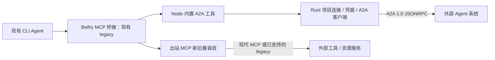

# 新协议接入方案：统一 A2A 协作层

核查日期：2026-11-15。任务：AI技术讨论 / T6，按最新任务备注执行。T1 代码基线：`f9d9d92`，初始应用版本 `1.0.8`。本报告是接入设计，尚未实现生产功能。

**用户已选择 A2A 1.0，并要求完整替代和删除 Belfry 协作 Skill。** 最终交付是统一的 A2A 协作层：宿主客户端连接标准外部 Agent，本地 Gateway 为托管 CLI Agent 提供 Card、消息 / 任务接口和执行适配；房间、任务板与收件箱保留为业务状态与权限引擎。新接入的标准 A2A 1.0 Agent 可通过 Card 使用通用协议；普通 CLI 仍需要执行适配，不能承诺任意 CLI 天然支持 A2A。

T8 / T9 先完成已明确的客户端基础：设置中的项目连接、受保护的静态认证、Agent 工具发现 / 发送 / 查询 / 续接 / 取消。T8 负责 Rust / IPC / 宿主回调，T9 负责前端 / Node；T11 / T12 完成 Gateway、本地显式报告和 Skill 迁移，T13 验收全部，原 T10 已归档。全部范围完成后才能宣称整体替换。无需再次确认方向。MCP `2026-07-28` 和 MCP Apps 保留为已核实备选，不属于本轮生产实施。

## 统一网关、本地适配与 Skill 迁移

本地 Gateway 发布活动 Agent 的 Card 和 JSONRPC / 1.0 接口，连接注册与会话生命周期联动。标准 SendMessage 经宿主校验项目、会话、目标、房间角色与依赖，再交给现有收件箱 / 终端调度执行；GetTask 读取任务板的权威状态和已报告结果；CancelTask 依据调度层实际取消结果返回状态。RPC taskId 与房间任务号 / generation 有宿主映射，客户端句柄仍按归属隔离。

本地执行适配负责将协议消息送入各 CLI 支持的输入通道，并注入内置协议工具及简短的角色 / 任务规则。模型必须用可信工具显式报告开始、进度、需要输入、结果或失败；终端空闲、屏幕文本和 HTTP 200 都不能替代完成报告。报告工具验证活动应用 ticket、任务归属和 generation 后更新任务板，由 Gateway 转为标准 Task / Message / Artifact。取消 HTTP 等待与取消远端 / 本地执行继续分开；无法实际中止的任务返回不可取消，而不是伪造 CANCELED。

Skill 迁移必须覆盖启动安装、设置入口、成员上手说明、收件箱提示、网站与回归用例。停止安装捆绑的 Belfry 协作 Skill；迁移时只删除宿主可验证拥有的原样副本，保护用户修改过的 Skill 与其他技能。房间 / 收件箱提示改为可发现的协议工具，既有任务与权限数据保留。仅客户端和五项外部工具完成时不能删除旧入口并宣称已完成替换；必须先验证 Gateway 到 CLI 再到显式结果报告的闭环。

| 新增范围 | 验收边界 | 文件分工方式 |
| --- | --- | --- |
| 本地 Gateway / Card / RPC 与任务映射 | 真实 HTTP 发现、SendMessage、GetTask、CancelTask；双项目 / 双会话隔离、未知或失效会话拒绝 | 后续任务明确 Rust Gateway 与 room / inbox 适配文件负责人 |
| 本地报告与自动注册工具 | 真实 MCP 目录可发现，活动 CLI 能报告结果 / 问题；重开和卸载后旧票据无法报告 | 后续任务明确 Node 工具、前端状态和适配器负责人 |
| Skill 删除迁移 | 新启动不再安装协作 Skill，原样副本可迁移删除，自定义副本受保护；日常协作全程无需调用该 Skill | 后续任务明确 setup、注入提示、文档及回归负责人 |

最终验收需要实际本地 Agent 协作和标准 HTTP 客户端互操作证据；客户端 fixture、Node mock 或文档检查均不能单独证明本地协作替换完成。

## 官方证据与项目实际差异

版本、发布日期和兼容事实以 [T7 官方技术核查](technology-scan.md) 及下列官方来源为准，核查日期均为 2026-11-15。协议版本日期、软件补丁号和扩展规格版本分别记录。

| 候选 | 已核实的官方事实 | 相较当前 Belfry 新增的机制 | 首期条件与代价 |
| --- | --- | --- | --- |
| **A2A 1.0 客户端** | 官方 [v1.0.0](https://github.com/a2aproject/A2A/releases/tag/v1.0.0) 发布于 2026-03-12；[v1.0.1](https://github.com/a2aproject/A2A/releases/tag/v1.0.1) 补丁发布于 2026-05-28。wire 版本为 Major.Minor，即 `1.0`；以 [v1.0.1 标签 Proto](https://raw.githubusercontent.com/a2aproject/A2A/v1.0.1/specification/a2a.proto) 核对实际字段 | Agent Card、按 interface 选择传输、跨系统 Message / Task / Artifact、独立远程任务生命周期；仓库目前没有 A2A 客户端或服务端 | 外部服务需要支持 JSONRPC / 1.0；宿主有界 HTTP 与轮询承载客户端调用。本地 fixture 无模型费用；真实 Agent 的运行成本由该服务决定 |
| **MCP 2026-07-28 新旧互操作** | 官方 Current 为 `2026-07-28`；[正式发布文章](https://blog.modelcontextprotocol.io/posts/2026-07-28/) 明确发布于 2026-07-28。具体破坏性变化见 [changelog](https://modelcontextprotocol.io/specification/2026-07-28/changelog.md) | 无 initialize 的请求级版本 / 能力声明、`server/discover`、无协议 session 的 HTTP、`subscriptions/listen`、多态结果；当前出站仍先请求 `2024-11-05` initialize | 可以让现有 CLI 使用只支持现代协议的外部工具服务；需要版本、传输、结果、缓存和订阅适配，不能只替换版本字符串 |
| **MCP Apps / WebMCP 互操作** | Apps Stable 规格为 `2026-01-26`；[SDK v2.1.0](https://github.com/modelcontextprotocol/ext-apps/releases/tag/v2.1.0) 发布于 2026-11-10，包含 WebMCP 互操作；相关 WebMCP 规格涉及 draft。SDK 版本不等于 Stable 规格版本 | 标准化工具关联 UI 资源、App / Host 通信和 WebMCP 工具互操作；现有 PI 面板的 `pluginBridge` 并不实现该协议 | 需要真实 MCP Apps 服务、UI 资源加载、沙箱与 AppBridge；仅升级依赖不会使现有面板自动兼容。适合明确需要交互工具界面的后续任务 |

T1/T2 的历史元数据方案已归档。本轮候选均以新协议机制及实际互操作为目标，最终接入完成必须有真实入口和可复现调用证据。

## 两条连接方向

下图是候选架构，两条出站路径可以分别实施。



**入站 Agent → Belfry** 当前由 [McpServer](../../src-tauri/src/plugins/node/mcp-server.mjs)、[dispatch](../../src-tauri/src/plugins/node/mcp-dispatch.mjs) 和 [stdio 桥接](../../src-tauri/src/plugins/node/mcp-stdio.mjs) 承担；入站 initialize 接受 `2024-11-05`、`2025-03-26`、`2025-06-18`。Belfry 签发的 Authorization 票据绑定工作区、实际会话、撤销和调用取消，这是应用授权机制，不能因为现代 MCP 删除协议 session 而删除它。

**出站 Belfry → 外部系统** 分别由 Rust 宿主 A2A 客户端和现有 [McpPeer](../../src-tauri/src/plugins/node/mcp-peer.mjs) / [McpHttp](../../src-tauri/src/plugins/node/mcp-http.mjs) 承担。T8 / T9 不迁移入站到现代 MCP；本地 CLI 的 A2A 发布与执行适配在 Gateway 阶段实现，不能因 tab 存在就视为已有 A2A Server。

## A2A 首期：宿主客户端、项目连接与 Agent 工具

### 真实用户入口

1. 在设置的 Agent 分组进入 **A2A 连接**，选择当前项目，新增连接名称、Card URL 和可选的指定 JSONRPC interface。仅有服务地址时可构造 origin 下的 `/.well-known/agent-card.json`。
2. 选择匿名、静态 Bearer 或 header API-key。编辑现有连接时机密操作明确为 keep / replace / clear；界面只显示是否已配置，宿主不把原凭据返回前端或 Node。
3. 检测 Card，显示名称、说明、skills、兼容 interfaces 与认证 / 版本问题。按声明顺序选择 JSONRPC / 1.0；用户可指定兼容 interface。检测是发现与兼容性核查，不自动发送有成本的任务。
4. 保存连接后，当前 CLI Agent 刷新现有 MCP 工具目录。`A2AConnections` 只列当前项目的脱敏连接；`A2AAgentCard` 以连接 ID 发现 Card；`A2ASendMessage` 发送用户指定文本，不自动发送整个仓库或会话历史。
5. 即时 Message 正确显示；Task 返回宿主句柄与真实状态。使用 `A2AGetTask` 轮询查询进度 / 产物；需要补充输入时再次 SendMessage，传入原宿主句柄；停止远端任务使用 `A2ACancelTask`。
6. 连接更新 / 删除、项目切换、会话撤销和本地请求取消均有明确状态。停止等待与远程取消分开处理，不把 WORKING、INPUT_REQUIRED 或 AUTH_REQUIRED 显示成成功。

T8 / T9 的客户端阶段使用 JSONRPC HTTP 轮询，SSE、webhook 与 OAuth 首期不支持。A2A 服务端及本地执行适配属于后续 Gateway 任务；最终删除协作 Skill，保留房间、收件箱与任务板数据。阶段验收与整体替换验收分别报告。

### 为什么采用宿主受控通道

现有插件 `pi.net.fetch()` 受静态 net.domains、短请求 / entry 级取消约束；普通插件 settings 明确拒绝 secret 存储。这些事实见 [network.mjs](../../src-tauri/src/plugins/node/network.mjs)、[manifest-fields.mjs](../../src-tauri/src/plugins/node/manifest-fields.mjs) 和 [settings.mjs](../../src-tauri/src/plugins/node/settings.mjs)。固定域匿名 / 内存 token 插件可用于演示，不能代替本轮真实可配置连接与持久化静态认证。

宿主独立保存项目连接，复用已有 OS 密钥与认证密文的存储机制，隔离 A2A 与 Provider 的命名空间；不能把 Provider API Key、CLI 登录态或普通插件 settings 当作 A2A 凭据。连接公开数据只含 auth kind / headerName / hasCredential。Node 工具只有连接 ID、文本或任务句柄，没有任意 URL / header / 凭据参数。

具体 Tauri、Node platform、公开类型、keep / replace / clear、返回包装和取消契约见 [A2A 前后端接口契约](a2a-contract.md)。此契约应先在 T8 任务板发布，T9 据此并行开发。

### 精确 wire 契约

以 [v1.0.1 标签规格](https://raw.githubusercontent.com/a2aproject/A2A/v1.0.1/docs/specification.md) 和 Proto 为准，而不是照搬旧 `0.3` 示例。

- Card 必需 name、description、version、supportedInterfaces、capabilities、defaultInputModes、defaultOutputModes、skills。interface 含 url、protocolBinding、protocolVersion；仅选择 JSONRPC / 1.0，有 tenant 时每次放入 params.tenant。
- JSON 字段 lowerCamelCase，enum 使用原样 `ROLE_USER` / `TASK_STATE_*`；文本 Part 为 `{ "text": "..." }`，不含旧 kind。AgentSkill 描述能力，标准 SendMessage 没有通用 skillId 路由参数。
- 每次 JSONRPC 请求发送 `A2A-Version: 1.0` 和 `Content-Type: application/json`。`application/a2a+json` 属于 HTTP+JSON / REST binding 的规则，首期不能混用；补丁号不放入 wire 版本。

最小非阻塞发送 body 如下；RPC ID、messageId 独立生成，tenant 从已选 interface 加入：

```json
{
  "jsonrpc": "2.0",
  "id": "request-1",
  "method": "SendMessage",
  "params": {
    "message": {
      "messageId": "message-1",
      "role": "ROLE_USER",
      "parts": [{ "text": "请分析这段接口需求并给出建议。" }]
    },
    "configuration": {
      "returnImmediately": true,
      "acceptedOutputModes": ["text/plain", "application/json"],
      "historyLength": 0
    }
  }
}
```

| 操作 | 必须构造 / 识别的结构 |
| --- | --- |
| SendMessage | result 恰含 task / message 一种；即时 Message 不伪造 Task。宿主规范化包装与远端 wire 包装分别说明 |
| GetTask | params 含远端 id、historyLength: 0 和可选 tenant；远端 result 直接为 Task，不含 result.task |
| CancelTask | params 含远端 id 和可选 tenant；远端 result 直接为 Task，真实状态决定取消结果；`-32002` 是 TaskNotCancelable |
| 补充输入 | 新 SendMessage 使用新 RPC ID / messageId，从归属句柄恢复 taskId / contextId；不接受任意外来 taskId，终态不续接 |
| Task / Artifact | Task 必含 id、status.state，可有 contextId / artifacts / history；Artifact 必含 artifactId / parts。文本和 JSON data 有界处理，文件内容 / URL 不自动下载 |

SUBMITTED / WORKING 未完成，INPUT_REQUIRED / AUTH_REQUIRED 是中断；COMPLETED、FAILED、CANCELED、REJECTED 是终态。保留完整 wire enum 与错误 / 拒绝区别，未知状态不能转成成功。

### 认证、授权与生命周期

读取 Proto 中 securitySchemes / securityRequirements，要求同一个 requirement 内全部方案满足，数组里的 requirement 为备选；检查 skills 的附加认证。支持匿名、httpAuthSecurityScheme.scheme=bearer 和 apiKeySecurityScheme.location=header。header API-key 必须匹配声明的 header 名；query / cookie、OAuth / OIDC / mTLS 明确不支持。

远端 Card / interface 为无内嵌凭据的 HTTPS URL；HTTP 仅用于显式 loopback fixture。禁止自动重定向和自动跨 origin 转发凭据。首次发现跨 origin interface 时要求用户指定该接口；更换凭据 origin 不允许以 keep 悄悄复用旧机密。私有 Card 与 RPC 不同 origin 的多套认证首期不提供。

使用现有应用签发的 Agent ticket 作为连接 generation，由 Rust 核对 ticket 对应的活动 PTY 和 canonical workspace；Node 传可信执行 context，用户工具参数不能设定 owner。内置工具直接使用 McpServer context，不依赖插件 public context 的原生历史 ID。无需向插件公开 Bearer token 或增加可伪造的身份字段。

任务句柄在宿主随机生成，至少绑定项目、有效 Agent generation、连接 ID / revision、远端 taskId / contextId、已选 interface / tenant。GetTask / CancelTask 只恢复本连接的句柄；相同远端 ID、同项目两个 Agent、重开同名会话不能越权复用。连接更新 / 删除和会话撤销回收对应句柄并取消在途请求。

请求 ID 与归属共同绑定本地取消注册表。取消必须唤醒并丢弃在途 HTTP future，不能仅在响应后检查标志；会话撤销和连接更新 / 删除也如此。每请求设字节 / 时间 / 并发上限，完整 JSON-RPC ID / result / error 关联校验，不将 HTTP 200 当作任务完成。

超时 / 断线后不自动重发 SendMessage；官方只允许服务自行按 messageId 去重，不能承诺恰好一次。发送结果未知时说明不确定状态。GetTask 采用短请求轮询；本地取消与会话撤销中断等待，已被远端接受的任务仍需显式 CancelTask。首期不保证关闭本地会话会自动终止远端已开始的工作。

### T8 / T9 文件分工与 T13 验收

| 文件范围 | 实施内容 | 负责人 |
| --- | --- | --- |
| `src-tauri/src/a2a/` 的 contracts、store、card、client、runtime、commands、platform 等 Rust 模块及定向 tests | 项目 CRUD、密文认证、Card / interface / auth、JSONRPC、句柄 / 取消与明确错误；测试使用注入的机密后端和本地服务 | 工程1 / T8 |
| `src-tauri/src/lib.rs`、必要的 `plugins/engine/platform.rs`、`plugins/agent_connection.rs` / `engine/embedded.rs` | 注册状态 / IPC / Node 回调、核验 Agent generation、撤销 / 退出清理、登记 T9 新 Node 模块；以小补丁保留其他会话差异 | 工程1 / T8 |
| `src/a2a/`、Settings 的 Agent 分组入口、前端 API / 类型和双语文案 | 项目连接配置、检测 / interface 选择、机密 keep / replace / clear、保存 / 删除及错误状态 | 工程2 / T9 |
| `src-tauri/src/plugins/node/mcp-a2a-tools.mjs`、现有 MCP 工具目录 / dispatch 接线及 Node / 前端用例 | 五项内置工具，只有脱敏连接与宿主句柄；构造可信 owner、联动本地取消；无任意 URL / 凭据输入 | 工程2 / T9 |
| `docs/ai-research/a2a-guide.md`、website 中英实际入口 | 配置、发现、发送、查询、补充输入、取消和真实服务条件 | 工程2 / T9 |
| 独立 fixture、最终集成 / 原生 / 构建检查与证据 | 用最终 T8/T9 与 T11/T12 代码验证完整流程，按 README 完成受影响与必需检查，统筹汇总最终结果 | 工程2 / T13、统筹 / T3 |

| 必须验收的情境 | 可观察结果 |
| --- | --- |
| 本地完整流程 | 真实 UI 配置 / 检测 / 保存；真实 MCP 工具发现并发送；WORKING 后 GetTask 查询到文本 Artifact / COMPLETED，另一个 Task 真正取消 |
| 精确版本 / interface | GRPC 优先、JSONRPC 后项、0.3-only、tenant、请求头 / PascalCase 方法 / enum / Part / returnImmediately、两种 SendMessage 与直接 Task 返回均独立断言 |
| 认证与机密 | 匿名、Bearer、header API-key、401/403、技能附加要求 / 不支持方案；keep / replace / clear 与 origin 绑定正确；公开响应 / Node / 磁盘普通 metadata 无原凭据，机密后端不可用不回退明文 |
| 结果 / 中断 | 即时 Message、INPUT_REQUIRED 续接、AUTH_REQUIRED、FAILED、REJECTED、未知状态和 TaskNotCancelable 均真实展示，不伪造完成 |
| 隔离与撤销 | 两个项目、同项目两个 Agent、两个目标同远端 ID；错误 owner / 旧 generation / 已删或更新连接不可查询或取消；撤销一个请求不影响另一个 |
| 本地取消 / 不确定发送 | 取消真正关闭 HTTP / 停止轮询；超时不重发 SendMessage；本地停止与远端 CancelTask 结果分开 |
| 生产边界 | Node 模块进入内嵌宿主，Tauri / TS 类型与 IPC 对齐；真实外部服务需要兼容 Card / interface、域名 / 凭据，另记录服务 / 日期 / 结果，本地 fixture 不证明任意公开服务或六种 CLI 全部互通 |

## MCP 首期：出站现代服务互操作，入站继续 legacy

用户仍在插件中心配置 / 安装声明 MCP 服务的插件。实施后，现有 CLI 的 `PluginTools` / `PluginCall` 可以发现并执行 **modern-only 外部 MCP 服务**，外部服务的工具 / Prompt / 资源目录变化能触发更新。无需模型 API Key；stdio 启动环境和 HTTP 认证沿用现有显式配置。

首期覆盖：出站 stdio 与现代 Streamable HTTP 的发现、请求级 metadata、普通 complete 结果、工具 / Prompt / 资源 / 模板及列表变化订阅；保持已测试 legacy 路径。资源内容订阅、完整 MRTR、Tasks / Apps 扩展、外部 OAuth 流程和入站现代服务器是独立范围。

### 发现与版本状态机

为每个 peer 保存 `{ era, version, capabilities, discovery, configEpoch }`，不再通过“是否有 initialize 结果”隐含判断协议。现代版本仅选择本地实现并验证过的 `2026-07-28`，不把服务声称的未来版本当作自动支持。

1. 发只读 `server/discover` 探针，带完整现代 `_meta`；HTTP 同时带匹配的标准 header。
2. 合法 DiscoverResult 表示现代，选择支持集合的交集。结果必含 `resultType: "complete"`、supportedVersions、capabilities，以及 CacheableResult 的 ttlMs / cacheScope；serverInfo 为 SHOULD，instructions 可选。
3. 已定义现代错误 `-32020`（header）、`-32021`（缺 capability）、`-32022`（版本）均保留现代分支。`-32022` 的 data 为 `{ supported: [...], requested: ... }`；没有本地支持交集则明确不兼容，不盲目 initialize。
4. **stdio：** 其他错误或合理探测超时才尝试旧 initialize。不能只对 `-32601` 降级；旧服务也可能返回 `-32602`、自定义错误或不响应。
5. **HTTP：** 先有界解析 HTTP 400 的 JSON-RPC body；已定义现代错误先修正请求 / 选版本，其他 400 才按官方兼容规则尝试旧 initialize。401/403、网络失败、TLS / 重定向错误不是版本降级依据。
6. HTTP 404 的 JSON-RPC `-32601` 表示 RPC 方法不存在，不自动打开旧 SSE。对旧服务的 200 unknown-method / 不含现代标志的探针回复，可在同一 POST endpoint 尝试一次 legacy initialize，成功才记录 legacy；这是为现有宽松 fixture / 服务保留的项目兼容策略，不等同官方全部旧传输覆盖。出现 supportedVersions / resultType 等现代标志但形状非法时明确失败，不能通过降级掩盖畸形现代响应。

探测采用独立、可测试的短超时，不能让老 stdio 服务在每次调用时多等现有 20 秒 RPC 上限。协议年代按 stdio 进程 / HTTP origin **加完整配置与认证身份** 缓存；配置、凭据或进程更换后重新探测。未来版本 / 版本错误的修复重试有上限，不重放已经开始或结果不确定的工具调用。

legacy 分支保留当前 initialize、initialized 通知、已测试 HTTP session / GET / DELETE 行为。仓库的 HTTP 代码不等于已实现 `2024-11-05` 的独立 SSE endpoint / endpoint event 传输；该已弃用传输首期不新增。

### 每次请求、HTTP header 和无协议 session

每个现代请求，即使没有业务 params，也发送：

```json
{
  "jsonrpc": "2.0",
  "id": 1,
  "method": "tools/list",
  "params": {
    "_meta": {
      "io.modelcontextprotocol/protocolVersion": "2026-07-28",
      "io.modelcontextprotocol/clientCapabilities": {},
      "io.modelcontextprotocol/clientInfo": {
        "name": "belfry-plugin-host", "version": "1.0.8"
      }
    }
  }
}
```

metadata 由宿主构造。不能把入站 CLI 的版本、capabilities、身份、会话票据或未经支持的扩展原样转发成出站权限 / 能力。普通 RPC ID 由该 peer 生成；并发会话只取消各自对应的请求。

现代 HTTP 每次单消息 POST，接受 JSON 和 request-scoped SSE 两种响应，并发送 `MCP-Protocol-Version`、`Mcp-Method`；`tools/call`、`prompts/get`、`resources/read` 另发送 Mcp-Name，分别取实际上游名称 / URI。版本 header 与 `_meta` 必须一致。

按 [HTTP 规范](https://modelcontextprotocol.io/specification/2026-07-28/basic/transports/streamable-http.md) 实现 `x-mcp-header`：

- 仅允许经 properties 链静态到达的 string / integer / boolean 参数；不得经过数组、组合 / 条件关键词或 `$ref`；number 类型无效，integer 为 JS 安全整数。
- 名称非空、符合 HTTP token 且大小写不重复；HTTP 上无效 annotation 的工具单独排除并报告原因，不污染其他工具。
- 提取对应 arguments 路径，值缺失 / null 时省略。构造 Mcp-Param-*；布尔值小写，整数十进制。
- Mcp-Name 和参数 header 使用官方 `=?base64?{UTF8 Base64}?=` sentinel：非 ASCII、控制字符、首尾空白及原值恰匹配 sentinel 时编码。不能直接拼接不安全 header，也不能让自定义配置覆盖版本 / 方法等宿主 header。

现代分支不存储 / 发送 Mcp-Session-Id，不发独立 GET、DELETE 或 Last-Event-ID，不发 initialized、ping、logging/setLevel 或旧资源 subscribe。Belfry 入站的应用授权票据继续存在，不向外部服务泄漏。

### 结果、多轮输入与 legacy 转换

[基本规范](https://modelcontextprotocol.io/specification/2026-07-28/basic/index.md) 和 [MRTR](https://modelcontextprotocol.io/specification/2026-07-28/basic/patterns/mrtr.md) 要求识别 resultType：

| 上游情况 | 适配行为 |
| --- | --- |
| 现代 `complete` | 先验证 RPC 关联和方法结果形状，再进入既有工具 / Prompt / 资源路径 |
| legacy 缺 resultType | 当作 complete，保留旧工具行为 |
| 现代缺 / 未知 resultType | 明确协议错误；不能把未知扩展结果当最终数据 |
| `input_required` | 首期不声明 roots / sampling / elicitation，明确返回“需要未支持的客户端输入，调用未完成”；不执行嵌入请求、不请求用户提供的凭据、不自动重放原调用 |
| 现代普通服务器主动发送 JSON-RPC request | 按非法 / 未支持的旧交互模式处理，不误当通知或调用本地工具 |

本轮仅保证不要求 MRTR 客户端功能的服务互操作；完整 MRTR 还需 inputRequests / inputResponses、原请求重试、新 ID、opaque requestState 和用户交互授权，不能宣称本轮已实现。

现代 structuredContent 允许任意 JSON；当前 [mcpToolResult](../../src-tauri/src/plugins/node/mcp-validation.mjs) 只允许对象。转换需发生在出站版本边界：对象继续保留；数组 / 标量 / null 生成有界 JSON text 内容并移除 legacy 不支持的 structuredContent，不重新包装为假对象。原 content、isError、图片 / 音频和资源 URI 命名空间继续正确；不能把不同结构称为 schema 保真。

首期继续桥接对象型输入工具，对当前 legacy 工具链无法表达的 schema 明确排除并说明原因，不改成 `{ type: "object" }` 伪装支持。不自动联网解析 `$ref`，也不宣称已实现通用 JSON Schema 2020-12 输入 / 输出校验；元数据目录透传不作为本轮交付目标。完整新版 schema 支持是额外兼容边界。

### 缓存与列表新鲜度

[缓存规范](https://modelcontextprotocol.io/specification/2026-07-28/server/utilities/caching.md) 和 [DiscoverResult schema](https://modelcontextprotocol.io/specification/2026-07-28/schema.md#discoverresult) 明确：server/discover、tools/list、prompts/list、resources/list、resources/templates/list、resources/read 的 complete 结果均必含 `ttlMs` / `cacheScope`。现代形状需验证；旧版缺字段按立即过期 / 私有处理。

首期不做共享代理缓存。目录按 peer / 配置与认证身份保存，分页各页验证 TTL、scope，整目录使用各页最早过期时间；新鲜度过期后在下一次 tools/list / PluginTools / Prompt / 资源发现或调用前异步刷新，不把 TTL 当定时后台轮询间隔。resources/read 首期每次请求上游，因此不缓存资源正文。列表通知立即使目录过期。

缓存键包含方法和影响结果的参数（含 URI / cursor）；不得跨授权身份分享 private 结果，即使同 URL。分页 scope 应一致，游标失效从首页重新获取，有界去重 / 页数 / 字节检查保留。scope / 插件撤销后立即不可见，不能因为旧目录 TTL 尚未过期而继续授权调用。

### subscriptions/listen 与取消 / 重连

现代 peer 使用单独订阅生命周期，不复用现有短请求的 20 秒终止逻辑或 1024 总事件上限。

- 按 capabilities 请求 toolsListChanged、promptsListChanged、resourcesListChanged。首期不发送 resourceSubscriptions，也不宣称支持资源内容更新；其他类型不能仅因服务发来而转发。
- 首个属于该订阅的消息必须是 `notifications/subscriptions/acknowledged`。以 `params._meta["io.modelcontextprotocol/subscriptionId"]` 关联，值等于原 listen 的 JSON-RPC ID；accepted filter 必须是请求的子集。不支持的过滤项进入明确的降级状态，并依靠后续新鲜度检查。
- stdio 共用通道要区分普通 pending RPC 与订阅 Map，允许其他订阅 / 普通响应在 ack 前交错；错误 ID、缺 ID、越权 filter 和 ack 前属于本订阅的事件不能触发目录更新。
- HTTP 采用 POST response SSE，ack 单独设建连超时，ack 后允许长期空闲；保持每帧字节、缓冲、并发 / 速率配额和事件去抖。SSE comment keepalive 不算异常或业务事件。
- 先建立订阅并确认 ack，再读取初始目录；初始化 / 刷新期间事件记为待刷新，防止丢掉建连空窗变化。目录原子替换，替换后的旧 peer 事件不能撤销新目录。
- HTTP 取消关闭该 SSE / 请求 AbortController，不发送 notifications/cancelled；stdio 发送带对应 requestId 的 notifications/cancelled，普通现代请求超时也如此。取消不关闭其他会话的正常 RPC。
- 服务端结束要容纳 cancellation 页的 notifications/cancelled 与 subscriptions 页的 complete 响应两个信号，按原 listen ID 校验并幂等清理；不是用普通工具返回值结束订阅。
- 意外 HTTP 断线按有界退避重开 listen，使用新 ID，不发 Last-Event-ID；401/403 停止重试并暴露认证问题。stdio 意外退出时先撤回贡献，按插件仍有效的条件有界重启进程、重新探测、重建订阅和目录；在途工具结果标为丢失，不自动重放。
- 插件卸载、scope 变化、配置更新、宿主关闭时回收订阅 / 请求 / 子进程。任何重连都核查 entry 与 peer 是否仍为当前实例；请求、通知与资源 URI 都不能越过作用域。

### MCP 确切文件分工与验收

| 文件范围 | 实施内容 | 建议单一负责人 |
| --- | --- | --- |
| `src-tauri/src/plugins/node/mcp-peer.mjs`，拟新增 `mcp-protocol.mjs` | 年代探测、版本 / metadata、结果分类、错误 data 保留、有界重试、普通取消 / 进程重建与统一 capabilities 访问 | 工程1 / 协议实现 |
| `mcp-http.mjs`、`mcp-response.mjs`、`mcp-events.mjs`，拟新增 `mcp-subscriptions.mjs` / `mcp-headers.mjs` | HTTP 非成功 body、无 session 分支、标准 / 参数 header、独立订阅状态与 JSON / SSE 解析 | 工程1 / 协议实现 |
| `mcp-contributions.mjs`、`mcp-resources.mjs`、`mcp-validation.mjs` | catalog 新鲜度、替换 / 撤销、结果向 legacy 适配、单工具排除原因和 scope / request 隔离 | 工程1 / 宿主聚合 |
| `mcp-dispatch.mjs`、`mcp-agent-tools.mjs` | 仅在旧发现 / 调用入口增加出站目录新鲜度等待；保留入站版本、权限与工具结果约定 | 工程1 / 宿主聚合 |
| `src-tauri/src/plugins/engine/embedded.rs` | 新 Node 模块加入显式 SOURCES；从内嵌生产宿主校验可加载，不仅测源码目录 | 工程1 / 生产接线 |
| `scripts/plugin-tests/mcp-modern.case.mjs`、`mcp-modern-isolation.case.mjs`、`fixtures/mcp-modern-{stdio,http}.mjs`，受影响 legacy fixture / 用例 | 独立 modern-only / legacy-only / dual-era 服务，精确请求、header、结果、订阅和并发 / 撤销断言 | 工程2 / 独立验收 |
| `docs/ai-research/mcp-modern-guide.md`，实际回归证据 | 可安装示例 / 服务配置、发现 / 调用 / 更新 / 撤销步骤，记录真实 CLI 和外部服务条件 | 工程2 / 使用说明 |

上述 MCP basename 均位于 `src-tauri/src/plugins/node/`。具体新增模块数量由实现拆分决定，任务板应在动手前确认单一文件负责人；验收与指南文件由工程2负责。

| 必须验收的情境 | 可观察结果 |
| --- | --- |
| modern-only stdio / HTTP | fixture 拒绝 initialize / GET / DELETE / session；旧入站 CLI 路径可发现并执行其工具、读取 Prompt / 资源；HTTP 支持 JSON 和普通 request SSE |
| legacy-only / dual-era | stdio 的 -32601、-32602、自定义错误和探测超时均能合理回退；已定义现代错误不回退。旧 HTTP session / 通知 / 卸载和旧工具结果回归通过；双协议服务优先现代，旧客户端仍可经 legacy 桥接使用 |
| metadata / header | 每次 RPC 的必需 `_meta` 与 HTTP header 一致；A2A 的 tenant 等协议字段不混入 MCP 协议 metadata；ASCII / 中文 / 换行 / sentinel / null / 缺值、合法嵌套参数与非法 header annotation 均独立断言 |
| 结果与缓存 | complete、legacy 缺 resultType、unknown / input_required、对象 / 数组 / 标量 / null 的转换正确；必需 TTL / scope、逐页 scope、过期重取与 private 身份隔离可观察；不虚报完整 schema 校验 |
| 订阅 | ack / filter / ID、stdio 交错、HTTP 长期空闲 / keepalive、ack 前非法事件、graceful / cancelled 结束、断线新 ID 重订阅均覆盖；不再按短请求超时切断正常 listen |
| 跨会话与 peer 替换 | 同项目两个 Agent、两个工作区、同 URL 不同认证 peer；取消一个请求不影响另一个，旧 peer / 已卸载插件不能发布工具或通知，作用域变更后旧调用被拒绝 |
| 生产边界 | 新模块从内嵌宿主载入；CLI / 应用授权票据、惯性空目录桥接、原有图片 / structuredContent / 资源 URI、插件卸载 / 更新行为保持；真实 CLI 端到端与外部服务按实际可用条件单独记录 |

## MCP Apps 的接入条件

Apps 适用于“工具返回需要交互界面的结果”，与 A2A 远程任务和 MCP 核心传输是不同候选。现有 PI PanelServer / pluginBridge、浏览器控制和 HTML 文件展示不能直接当作 Apps Host。

若用户选择该路线，最小完整范围需要：发现工具关联的 UI resource、读取 `text/html;profile=mcp-app`、建立有界且带实例身份的 AppBridge / iframe 沙箱、按 host capabilities 限定 App 的工具调用、保留工具结果到 UI 的生命周期、卸载 / workspace 切换撤销，以及一项真实交互 App fixture。WebMCP 桥接还须核对浏览器是否提供相关能力及其 draft 版本；无该能力时提供可解释的禁用状态。SDK 2.1.0 的新增互操作不能证明 Belfry 已接入 WebMCP。

本轮仅列出该条件并引用 [Apps 官方概览](https://modelcontextprotocol.io/extensions/apps/overview.md) 与 T7 的 Stable / SDK / draft 证据，不同时修改插件面板或新增 Apps / WebMCP 生产实现。

## 实际验证与后续交付

本任务实际完成：只读核查生产插件 / MCP / 授权 / 网络 / 工具 context 接线；读取可访问的 MCP 官方协议文档、正式发布页及 A2A v1.0.1 标签规格 / Proto（HTTP 200）；更新本方案与架构报告开头。Apps 与 release 时间的核查证据由 T7 汇总。报告链接、空白 / 换行 / 代码围栏及补丁检查应在交差前执行并记录。

实施后优先运行独立新增 fixture 和受影响的 `scripts/plugin-tests/mcp*.case.mjs` / `network.case.mjs` / 生命周期用例。Node test runner 使用 `node --test`，`mcp-stdio.test.mjs` 使用 `pnpm exec vitest run`。新增宿主模块完成内嵌接线 / Rust 检查；涉及前端生产入口时按 [README](../../README.md) 执行 `pnpm build` 和相关浏览器回归。全量 / 原生 / 上游环境的必需检查由最终实施任务明确并如实记录。

本段记录 T6 交差时的状态：尚未执行新协议 fixture、真实 CLI / 外部 Agent 调用、生产构建或新功能验收。用户已选择统一 A2A 协作及 Skill 删除；T8/T9 实施客户端基础，T11/T12 实施 Gateway / 本地报告 / Skill 迁移，T13 验收全部最终代码。后续实际命令与结果以任务板交差和最终验收报告为准，完成设计报告不等于接入完成。
