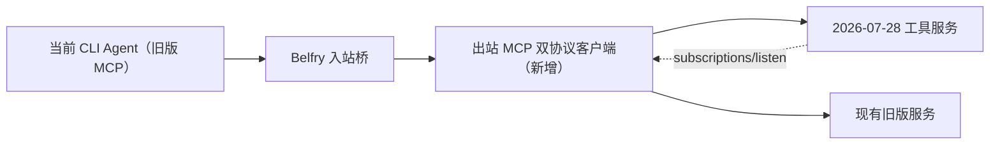

# Belfry 新发布 AI 协议技术核查

核查日期：**2026-11-15**。任务：AI技术讨论 / T7 最新协议选型备注。初始代码基线：`f9d9d92`，初始应用版本 `1.0.8`。

按用户最终目标与 T8/T9/T11/T12 分派，**本轮接入 A2A 1.0 外部客户端与本地 Agent Gateway**：项目外部连接、自动发现已就绪本地 Agent、统一 HTTP 任务委派／续写／查询／取消、受信任接收方显式回报，以及房间／任务板／收件箱工具；移除内置 Belfry 协作 Skill。JSON-RPC 轮询与文本为首期边界。外部连接支持匿名和静态 Bearer／Header API-key，本地实例凭据由宿主生成和保管。客户端、本地 Gateway 与工具已接通正式原生／嵌入 MCP／HTTP 链路；完整回归与真实 CLI、远端服务边界见 [T13 验收记录](a2a-validation.md)。源码改动尚未单独发布。

同时保留 **MCP `2026-07-28` 出站接入与旧版兼容** 的精确方案，它能接通只接受新版协议的工具服务；MCP Apps 则提供标准工具交互 UI。三者的新增能力、实施代价和兼容边界分别列出，生产范围以用户选择和任务板分派为准。

本报告以 MCP、A2A、MCP Apps 三项新协议／机制为核心，给出官方发布事实、项目缺口和可验收范围。具体文件分工由 [T6 接入方案](new-feature-plan.md) 确定；架构基础见 [项目评估](project-assessment.md)。本任务只重写本报告，生产代码与功能实现由后续任务交付。

## 官方版本与发布时间

| 技术 | 核查到的版本／状态 | 官方发布时间证据 | 对 Belfry 的实际增量 |
| --- | --- | --- | --- |
| **MCP** | 官方 Current：`2026-07-28` | Versioning 明确标为 Current；官方正式发布文章显示 **2026-07-28**，正文宣布新版及 SDK 正式发布。[M1]、[M2] | 接通 modern-only 上游；发现、逐请求版本／能力声明、无会话 HTTP、POST 订阅，替换当前旧握手机制 |
| **A2A** | 当前官方仓库最新正式 Release：`v1.0.1`；线上协议版本使用 `1.0` | `v1.0.0` Release 发布于 **2026-03-12**；`v1.0.1` 的 `published_at` 为 **2026-05-28T11:34:36Z**，非 prerelease。[A1]、[A2] | 通过 Agent Card 发现外部 Agent，以标准消息、任务状态和产物协议协作，支持跨框架／跨服务委派 |
| **MCP Apps** | Stable 扩展规格：`2026-01-26`；官方 SDK 最新正式 Release：`v2.1.0` | 规格标明 Created **2025-11-21**、Stable **2026-01-26**；官方文章在 **2026-01-26** 宣布上线；SDK Release 发布于 **2026-11-10T22:53:57Z**。[U1]—[U4] | 从上游 MCP 工具取得标准 HTML UI，宿主渲染并通过 Apps 协议传入结果、处理用户交互 |

**日期与版本的边界。** MCP 的版本日期表示最后一次不兼容变更日期，本次另有正式发布文章证明实际发布日期。[M1]、[M2] A2A 的 latest 文档与 `v1.0.1` 标签内的规格开头仍写 “Latest Released Version 1.0.0”；本报告同时保留这一页面事实和 Release API 的 `v1.0.1` 事实。其 Release body 的变更条目日期为 05-26，正式 `published_at` 为 05-28；不能混用。A2A 规范要求协商 **Major.Minor**，补丁号不参与兼容协商，因此请求头使用 `A2A-Version: 1.0`。[A1]—[A4]

MCP Apps 的 `v2.1.0` 是 SDK 版本，UI 协议仍按 Stable `2026-01-26` 核查。官方 README 说明 SDK 1.x／2.x 的 UI wire protocol 互通；draft 规格仍标为 Development，不能把 SDK 发布自动视为 Stable 规格升级。[U2]—[U4]

## 选型前基线已支持与真实缺口

| 链路 | 选型时源码事实（`f9d9d92`） | 选型时缺口 |
| --- | --- | --- |
| 出站外部 MCP 服务 | [mcp-peer.mjs](../../src-tauri/src/plugins/node/mcp-peer.mjs) 的 `start()` 请求 `initialize`，版本为 `2024-11-05`；目录能力来自 `peer.initialized` | 现代发现、版本选择和请求元数据；能力来源不能继续依赖旧握手结果 |
| 出站 HTTP | [mcp-http.mjs](../../src-tauri/src/plugins/node/mcp-http.mjs) 维护 `Mcp-Session-Id`、GET 通知流、DELETE 关闭；非成功响应先取消 body，只保留 HTTP 状态 | 按协议分支运行 HTTP；保留错误 body 以判断现代错误；现代分支用无会话 POST 订阅 |
| 入站 CLI 桥 | [mcp-dispatch.mjs](../../src-tauri/src/plugins/node/mcp-dispatch.mjs) 的 `initialize` 接受 `2024-11-05`、`2025-03-26`、`2025-06-18`；没有 `server/discover` | 出站升级不等于 CLI 或入站服务升级。首期保留旧入站；入站现代能力需独立任务和客户端证据 |
| 动态目录与资源 | 已有工具／Prompt／资源发现、分页和旧 `list_changed` 更新；[mcp-peer.mjs](../../src-tauri/src/plugins/node/mcp-peer.mjs) 未关联订阅 ID，忽略 `resources/updated`；[mcp-resources.mjs](../../src-tauri/src/plugins/node/mcp-resources.mjs) 检查旧初始化能力 | `subscriptions/listen` 生命周期与确认过滤；URI 内容订阅需要专门资源调用链路，不能用目录刷新代替 |
| 结果和流解析 | [mcp-validation.mjs](../../src-tauri/src/plugins/node/mcp-validation.mjs) 只接受对象型 `structuredContent`；[mcp-response.mjs](../../src-tauri/src/plugins/node/mcp-response.mjs) 处理短请求，遇匹配结果即返回且限 1024 个前置事件 | 现代结果类型、任意 JSON 结构化数据与旧版输出适配；长期订阅需专门流读取，不能当普通短请求 |
| 跨 Agent 与 UI | [房间协作](../../src/rooms/) 已有本地派活和任务板；[PluginPanel](../../src/plugins/PluginPanel.tsx) 与 [panel-bridge.mjs](../../src-tauri/src/plugins/node/panel-bridge.mjs) 使用 Belfry 自有面板桥 | 未找到 A2A Agent Card／任务客户端或 MCP Apps `ui/initialize`／AppBridge 接线；已有同名 UI 组件不能证明标准支持 |

该表保留接入前的核查基线；A2A 客户端与 Gateway 缺口已由 T8/T9/T11/T12 补齐，MCP 新版与 MCP Apps 仍为备选。基线检查覆盖生产路径、相关源码和依赖中的 `agent-card.json`、`SendMessage`、`SubscribeToTask`、`io.modelcontextprotocol/ui`、`ui/initialize`、`ext-apps` 等标识。动态工具、资源和 Skill 提供可复用基础，本轮新增完整协议流程。

## A2A 1.0：外部客户端与本地 Agent 协作

**新增能力。** 远程 Agent 提供身份、技能、输入／输出模式和连接接口的 Agent Card；Belfry 以标准协议发起工作、获取任务状态与产物、补充输入并尝试取消。外部 Agent 可使用其他框架并保留其内部工具／记忆。基线中的房间任务板采用本地协作协议，本轮为它补充 A2A 的 Card、HTTP 接口和任务生命周期映射。[A3]、[A4]

首期采用 **宿主客户端与项目连接管理、使用有界 HTTP 轮询**：用户配置外部 Card／服务 → 发现技能 → 发任务 → 读取状态／结果 → 补充输入或取消。T8 提供受控目标／凭据／请求通道，T9 提供连接界面和现有 MCP Agent 工具；T11/T12 已补充本机 Gateway 与实际 CLI 适配器，为本地 CLI 提供标准 A2A Server 与显式报告工具。流式、webhook 推送和 OAuth 仍不在首期范围。

### 最终本地接入范围与证据边界

本地 Gateway 使用同一 Rust HTTP 客户端、标准 Agent Card 与 SendMessage/GetTask/CancelTask，经现有投递引擎连接权威 TaskBoard、RoomStore 和 Inbox。接收方以实际 MCP ticket、活动 PTY、canonical 项目、Agent 实例、任务句柄与 generation 校验后显式回报；终端 idle 不能完成任务。这些本地执行／报告映射是 Belfry 的适配实现，A2A 规格本身不保证任意 CLI 可直接加入。

首期自动适配 MCP 注入的 Codex PTY / Claude PTY；`BELFRY_CODEX_NATIVE=1` 隔离路径和其他 CLI 不宣称支持。工具目录就绪后才登记本地连接；Node 使用受控薄工具，JS 不另写客户端或任务引擎。首次发现的身份握手总限时 2.5 秒，包含宿主等待与重试间隔；仍有效实例可在后续查询恢复就绪，撤销实例仍拒绝。业务写操作不自动重试。网关限 loopback 且 Card/RPC 需要实例认证，不对其他机器开放本地会话。

本地协作新增 10 个工具：发现、本人任务列表／全文、显式回报、收件箱、房间列表／上下文、发言／问题回复、统筹简报更新及任务规划／分派／重开／归档。原房间权限和持久业务状态保留，任务界面按完整 TaskRef 与 generation 关联独立协议预览；协议 working/input-required/failed 与业务状态分别展示，旧代次不得覆盖新任务。普通问题回复不会完成任务。内置中英协作 Skill 资产与安装入口移除；启动迁移只识别已知原样副本的哈希，修改副本、符号链接与其他 Skills 不删除。

同房间分派遵循原任务板规则；多间共同房间需明确房间。默认/false Send 等终态或需要输入，true 即时返回；historyLength 有界。尚未提交的 direct 可撤回，提交后或状态不确定可返回不可取消；房间无 cancelled 权威状态，首期协议取消明确拒绝。接口详见 [本地契约](a2a-local-contract.md)，实际用法见 [指南](a2a-guide.md)。

原生 HTTP 与 embedded Node、合成 Agent 身份、Node MCP 合成回调和浏览器合成 IPC 分别提供不同证据。真实 CLI 模型工具调用和任意远端 Agent 服务尚未测试；全部必需检查的实际数量、跳过项和可复现步骤见 [T13 验收记录](a2a-validation.md)。

### Card、接口与认证的精确结构

当前字段按 `v1.0.1` 标签内 **规范 Proto** 和渲染字段表核对。部分文字示例仍含旧 `security`／`protocolVersions`，不可直接照抄；当前使用 `securityRequirements` 和 `supportedInterfaces[].protocolVersion`。[A3]—[A5]

| 对象 | 首期需识别的字段 |
| --- | --- |
| AgentCard | 必需 `name`、`description`、`version`、`supportedInterfaces`、`capabilities`、`defaultInputModes`、`defaultOutputModes`、`skills`；`version` 是 Agent 软件版本 |
| AgentInterface | 必需 `url`、`protocolBinding`、`protocolVersion`；可选 `tenant`。首期选择顺序中第一个支持 **JSONRPC + 1.0** 的接口，使用该 URL；tenant 存在时放入每个请求的 params |
| AgentSkill | 必需 `id`、`name`、`description`、`tags`；可覆盖输入／输出模式及 `securityRequirements`，不能只检查全局 Card |
| 认证声明 | `securitySchemes` 是名称到 SecurityScheme 的 map；`securityRequirements` 是要求数组，其中 `schemes` 把方案名映射为 `{list: [scope]}`；凭据在协议外取得，逐请求传递 |
| 协议与内容类型 | 线上版本是 **Major.Minor=1.0**，JSON-RPC 每次发送 `A2A-Version: 1.0` 和 `Content-Type: application/json`。HTTP+JSON/REST 的 `application/a2a+json` SHOULD 规则属于另一个 binding，不能混用 |

发现支持 `/.well-known/agent-card.json`、显式 Card URL 或目录。[A3] 首期配置完整 Card URL 最清楚；从 Card 选择实际接口地址，不能假定发现地址同时就是 RPC 入口，也不能把未知版本当作 1.0。AgentSkill 用于能力描述；标准 SendMessageRequest 没有 skillId 字段。技能选择可作为任务文本上下文，服务特定的强制路由需核查其明确扩展，不能自行增加一个通用 skillId 参数。[A5]

下例为**本地匿名测试服务的 Card**，不指向实际部署。[A5]

```json
{
  "name": "Belfry A2A fixture",
  "description": "Local text task fixture",
  "version": "1.0.0",
  "supportedInterfaces": [
    {
      "url": "http://127.0.0.1:8766/a2a",
      "protocolBinding": "JSONRPC",
      "protocolVersion": "1.0"
    }
  ],
  "capabilities": { "streaming": false },
  "defaultInputModes": ["text/plain"],
  "defaultOutputModes": ["text/plain"],
  "skills": [
    {
      "id": "text-task",
      "name": "Text task",
      "description": "Return a deterministic fixture result",
      "tags": ["fixture"]
    }
  ]
}
```

若服务声明 Bearer 认证，当前字段片段为下例；客户端经受控凭据通道取得 token，放到每个请求的 Authorization 头，不把 token 填进 Card 或普通插件设置。[A3]、[A5]

```json
{
  "securitySchemes": {
    "bearer": { "httpAuthSecurityScheme": { "scheme": "bearer" } }
  },
  "securityRequirements": [
    { "schemes": { "bearer": { "list": [] } } }
  ]
}
```

静态 header API-key 的方案为 `apiKeySecurityScheme: {location: "header", name: "X-API-Key"}`；要求仍通过对应名称的 `securityRequirements[].schemes` 引用，值由宿主凭据存储取得并传给声明的 header。`query`／`cookie` 是规范允许的其他 location，但不在首期范围。[A5]

首期开放匿名／静态 Bearer／header API-key，其他必需方案明确不支持；不能忽略 OAuth、mTLS 或技能级认证后继续发送。401／403 与 `TASK_STATE_AUTH_REQUIRED` 是不同状态：前者为请求认证失败，后者为已接收任务需要额外授权，不能将其标为任务完成。

### 消息、任务和取消结构

以下是向选定 JSONRPC 接口发起**非阻塞文本任务**的 body。每个 RPC 使用独立 id，messageId 则标识业务消息；这两个 ID 的职责不同。[A3]、[A5]

```json
{
  "jsonrpc": "2.0",
  "id": "rpc-1",
  "method": "SendMessage",
  "params": {
    "message": {
      "messageId": "msg-1",
      "role": "ROLE_USER",
      "parts": [{ "text": "Produce a short fixture result" }]
    },
    "configuration": {
      "acceptedOutputModes": ["text/plain"],
      "historyLength": 0,
      "returnImmediately": true
    }
  }
}
```

任务响应使用 `result.task` 包装，如下。直接回答则使用 `result.message`，含 `messageId`、`role: "ROLE_AGENT"` 和 `parts`，不能因没有 task 而误判失败；一个 SendMessageResponse 恰好包含二者之一。[A5]

```json
{
  "jsonrpc": "2.0",
  "id": "rpc-1",
  "result": {
    "task": {
      "id": "task-1",
      "contextId": "context-1",
      "status": { "state": "TASK_STATE_WORKING" }
    }
  }
}
```

| 操作／对象 | 准确参数和返回 |
| --- | --- |
| GetTask | `method: "GetTask"`；params 示例 `{"id":"task-1","historyLength":0}`；result **直接是 Task**，没有 result.task 包装 |
| CancelTask | `method: "CancelTask"`；params 示例 `{"id":"task-1"}`，可有 metadata；result **直接是更新后的 Task**。发起取消不保证成功，`TaskNotCancelableError` 的 JSON-RPC code 为 `-32002` |
| 补充输入 | 仍调用 SendMessage；message 增加原 `taskId` 和已知 `contextId`，使用新 messageId 和新 RPC id，并携带新 `parts`；终态任务不能继续输入 |
| Task | 必需 `id`、`status`；可有 `contextId`、`artifacts`、`history`、`metadata`。status 必需 state，可有消息和 UTC timestamp |
| Message／Part | Message 必需 messageId、role、parts；角色是 `ROLE_USER`／`ROLE_AGENT`。文本 Part 为 `{"text":"..."}`，没有旧 kind；其他 oneof 成员为 raw、url、data |
| Artifact | 必需 `artifactId`、`parts`，可有 name／description／metadata；首期根据支持模式展示文本产物，不把任意下载 URL 自动作为已取得的文件 |

GetTask／CancelTask 的 params.id 是**远端任务 ID**；RPC body.id 是本次请求 ID。若接口声明 tenant，还必须把准确 tenant 放到各操作的 params。[A5]

进行中或中断状态包括 `TASK_STATE_SUBMITTED`、`TASK_STATE_WORKING`、`TASK_STATE_INPUT_REQUIRED`、`TASK_STATE_AUTH_REQUIRED`；终态为 `TASK_STATE_COMPLETED`、`TASK_STATE_FAILED`、`TASK_STATE_CANCELED`、`TASK_STATE_REJECTED`。`TASK_STATE_UNSPECIFIED` 或未知状态不能显示为成功。完成依据 status，而不是有文本、HTTP 200 或轮询停止。[A5]

首期用 GetTask 轮询，每次有请求超时，历史长度有界；关闭视图／取消本地等待应能终止在途请求和轮询定时器。**取消本地等待与 CancelTask 是两项操作**：前者不证明远端任务取消。网络超时后不要自动重发 SendMessage；规范只说服务器 MAY 用 messageId 去重，不能假定委派必然幂等。[A3]

如以后实现流式，先检查 streaming 能力；SendStreamingMessage／SubscribeToTask 返回 StreamResponse 的 task、message、statusUpdate、artifactUpdate 之一。SubscribeToTask 首条必须是当前 Task；产物更新按 artifactId、append、lastChunk 处理，终态结束流。首期仅轮询，不以短请求读取器宣称支持 SSE。[A3]、[A5]

### Belfry 接入边界、最小使用场景和验收

[network.mjs](../../src-tauri/src/plugins/node/network.mjs) 的 `pi.net.fetch` 受 manifest 静态 `net.domains` 限制，默认超时 15 秒、最多 30 秒，响应有 512 KiB 边界，取消信号只绑定插件 entry。它返回完整 bodyText，没有流 API，也没有每次工具请求／会话的 AbortSignal。插件 [manifest-fields.mjs](../../src-tauri/src/plugins/node/manifest-fields.mjs) 明确拒绝 `secret: true`；[settings.mjs](../../src-tauri/src/plugins/node/settings.mjs) 的普通设置文件不是凭据保险库。

因此须区分两种可交付范围：

- **固定域名匿名插件示例：**使用现有网络 API 可做 Card、SendMessage、GetTask、CancelTask 的短请求。只能配置声明允许的目标；关闭时可停止后续轮询，但现有 API 不足以保证单次请求／会话的真实中止。这是演示范围，不能称为任意外部服务客户端。
- **可配置目标的完整客户端：**由宿主提供受控 A2A 通道，把目标 URL／接口与项目、会话和调用身份绑定；配置目标与访问授权同步核对，支持请求级取消、轮询清理及受控凭据引用。不能用普通插件 token 设置或默认放宽所有网络域名替代该实现。确切 API／文件和凭据支持由 T6 方案划分。

建议的用户闭环：在插件／工具入口配置 Card → 展示远端名称、技能、实际 1.0 接口和支持的认证条件 → 选择技能并发送文本 → 显示返回 Message 或 Task → 定期读取真实状态和文本产物 → 需要输入时向原任务补充 → 可停止本地等待或请求取消远端任务，并分别显示实际状态。Agent 工具与视图使用同一受控客户端和任务句柄；句柄绑定服务／项目／会话，不能仅用远端 taskId 作为全局键。

| 首期验收 | 必需证据 |
| --- | --- |
| Card／接口 | 缺必需字段、0.3／不支持的 binding、输入模式不符、租户选择和支持接口排序均有断言；实际 RPC URL 与 Card URL 可不同 |
| 实际协议请求 | SendMessage／GetTask／CancelTask、1.0 版本头、application/json、ROLE_*、Part 及 tenant 正确；响应 RPC id 和 Task 结构验证 |
| 生命周期 | 直接 Message、submitted／working、input-required 补充、完成产物、失败／拒绝、授权中断、取消成功及 -32002 均覆盖；不把未完成当成功 |
| 认证与边界 | 匿名／静态 Bearer／header API-key、401／403、必需但不支持的认证、技能级要求和目标变更均可复现；普通设置／日志／返回结果不包含凭据 |
| 取消与隔离 | 本地停止真实中断在途请求和定时器；远端取消单独等待实际返回；同 taskId 在不同服务／项目／会话下不串用，撤销后拒绝迟到调用 |
| 完整入口 | 可安装产物或真实宿主入口完成配置 → 发现 → 发任务 → 进度／结果 → 补充／取消；本地 fixture 实测与真实外部服务结果分别记录 |

**成本与成熟度。** A2A 已有正式 1.0 系列规格和官方 SDK，但 0.3 → 1.0 存在破坏性变化，所选 SDK 的实际 wire 1.0 支持需核对，不能用协议 Release tag 代替 SDK 兼容证明。[A2]—[A5] 本地确定性 fixture 可无模型凭据；真实验收需一个实际 A2A 1.0 服务及其账号／授权，Agent 计算和模型费用由服务提供方决定，任意 Provider API Key 不是通用 A2A 凭据。本机 Gateway 不要求对外部署服务端；真实模型会话仍遵循各 CLI 的账号与费用。

## MCP 2026-07-28：工具服务兼容候选

### 新机制与兼容要求

相对 `2025-11-25` 及更早版本，官方变更包含以下机制。[M3]—[M11]

| 新机制 | 必须处理的协议事实 | 首期接入含义 |
| --- | --- | --- |
| 请求级元数据 | 移除 `initialize`／`notifications/initialized`；每个请求的 `params._meta` 带 `io.modelcontextprotocol/protocolVersion`、`io.modelcontextprotocol/clientCapabilities`；客户端身份建议逐请求提供 | 为现代请求统一编码，旧分支仍执行原握手；不把上一请求的身份／能力当作隐式上下文 |
| 服务发现 | 现代服务器 MUST 实现 `server/discover`；结果含 `supportedVersions`、`capabilities`，身份位于结果 `_meta` 的 `io.modelcontextprotocol/serverInfo`；complete 结果也必须含缓存提示。[M12] | 用正式发现选择版本及能力；自报身份只供展示和诊断，不能替代鉴权 |
| 无协议会话 HTTP | 移除 `Mcp-Session-Id`、GET 通知入口、DELETE 协议会话关闭，以及 SSE `Last-Event-ID` 恢复 | 现代分支只使用规定的 POST 请求和响应流；保留 Belfry 的应用身份、授权范围和撤销 |
| HTTP 路由头 | 每个请求必须有 `MCP-Protocol-Version`、`Mcp-Method`；`tools/call`、`resources/read`、`prompts/get` 还需 `Mcp-Name`，与 body 对应字段一致 | 实现安全的 ASCII／Base64 sentinel 编码；工具 schema 含 `x-mcp-header` 时按规范映射参数头或明确限制支持范围 |
| 新订阅模式 | `subscriptions/listen` 通过过滤器选择目录变化／资源 URI；第一个消息为 `notifications/subscriptions/acknowledged`；progress／message 只在所属操作响应流 | 比较请求与确认的过滤器；只接收已确认类型；订阅 ID 等于原请求 JSON-RPC ID |
| 结果与 MRTR | 结果必有 `resultType: "complete"` 或 `"input_required"`；旧结果缺字段视为 complete；MRTR 用原操作的新请求回传 `inputResponses`／原样 `requestState` | 识别未完成状态；未实现的交互能力不广告、不伪装为成功内容；未知结果类型拒绝 |
| 缓存与 schema | server/discover 与指定的目录／读取 complete 结果必须含 `ttlMs`、`cacheScope`；MRTR 重试不能缓存。[M12] `structuredContent` 放宽为任意 JSON，schema 使用 JSON Schema 2020-12 | 处理新数据契约；缓存按授权范围隔离，private 不共享；旧 CLI 输出需适配；完整 schema 验证不能凭版本字段宣布已实现 |

### 新旧服务识别

1. **stdio：**双协议客户端先以首选现代版本发送 `server/discover`。正常 DiscoverResult 表示现代服务；`UnsupportedProtocolVersionError (-32022)` 等已定义现代错误也表示现代服务，应选共同支持的现代版本或修正请求，**不能退回 initialize**。其他错误或合理探测超时才走旧握手。旧实现可能返回 `-32601`、`-32602` 或保持静默，不能只按一种错误码降级。[M3]、[M5]
2. **HTTP：**可先发送现代发现请求；收到 400 要读取错误 body。`HeaderMismatch (-32020)`、`MissingRequiredClientCapability (-32021)`、`UnsupportedProtocolVersion (-32022)` 要按现代错误处理。普通 400 的空／非现代错误 body 才触发旧握手。鉴权失败应报告认证问题，不能当作协议识别成功。[M6]、[M8]
3. **旧 HTTP+SSE 单独划范围：**官方旧传输回退涉及 400／404／405 的非现代错误、GET 建流与 `endpoint` 事件；它不同于较早 Streamable HTTP 的 GET 通知流。本仓库当前 `McpHttp` 并未实现 `endpoint` 事件协商，因此首期应只承诺保留已验证的旧 stdio／Streamable HTTP 路径。[M6]
4. **服务身份与作用域：**协议类型识别可按 stdio 进程或 HTTP 服务配置缓存，配置／凭据变更或缓存假设失效时重探测。版本、能力、授权与资源映射必须绑定同一服务；不能让另一插件／工作区复用错误的身份或私有数据。[M3]、[M8]
5. **版本广告与实现范围：**出站客户端支持新版不意味着入站 CLI 桥已实现新版。本轮保留旧入站广告；若后续增加现代入站，必须单独完成发现、元数据验证、结果包装、订阅与隔离验收。

现代发现请求形状如下，`clientInfo` 为示例 fixture 身份。[M4]

```json
{
  "jsonrpc": "2.0",
  "id": "discover-1",
  "method": "server/discover",
  "params": {
    "_meta": {
      "io.modelcontextprotocol/protocolVersion": "2026-07-28",
      "io.modelcontextprotocol/clientInfo": {
        "name": "belfry-modern-fixture",
        "version": "1.0.0"
      },
      "io.modelcontextprotocol/clientCapabilities": {}
    }
  }
}
```

HTTP 发送同一 body 时还需 `Accept: application/json, text/event-stream`、`Content-Type: application/json`、`MCP-Protocol-Version: 2026-07-28`、`Mcp-Method: server/discover`。发现请求不需要 `Mcp-Name`。[M6]

### 订阅、取消与结果边界

- 目录订阅过滤器为 `toolsListChanged`、`promptsListChanged`、`resourcesListChanged`；资源内容使用 `resourceSubscriptions: [uri]`。确认只包含服务器实际支持的子集；未确认的项不能视为订阅成功。[M7]
- 订阅确认与通知都带 `params._meta["io.modelcontextprotocol/subscriptionId"]`。stdio 多个订阅共享一条通道，必须按此字段分流；同一服务不同订阅的消息可以交错，首个确认的顺序按订阅 ID 约束。[M5]、[M7]
- HTTP 的长期 POST 响应流、stdio 的 pending 订阅均不能使用普通 20 秒 RPC 完成超时。可以设置确认超时和可取消生命周期，SSE keepalive 注释必须忽略，不能累计为无效事件。[M6]、[M7]
- HTTP 客户端关闭 SSE 流即取消，不另发 `notifications/cancelled`；stdio 则必须发该通知引用原请求 ID。订阅页规定服务端主动结束 SHOULD 发 complete 响应，取消页另规定 MUST 发 `notifications/cancelled` 终止该订阅。客户端应容纳两个信号，并幂等清理。[M5]—[M7]、[M10]
- 断线不能通过 Last-Event-ID 续传；stdio 重连必须重发订阅。重新发起请求使用新 ID；订阅恢复不应额外重放已发出的工具调用。丢失响应也不能证明有副作用的工具未执行。[M6]、[M7]、[M11]
- `input_required` 只能用于规范允许的操作。服务器不得请求客户端未声明支持的交互能力。首期可不声明 sampling／elicitation／roots；遇未实现交互返回明确未完成／不支持状态。若实现 MRTR 重试，须原样回传 requestState、使用新 ID、限制轮次，并只绑定原操作。[M9]
- 现代数组／标量 `structuredContent` 与旧 CLI 的对象契约不同。内部数据和文本 content 保留，向旧入站返回时需按该版本生成合法结果或明确拒绝不兼容内容；不能将现代类型无条件标为旧规格合规。[M8]、[M11]

### 最小完整接入与验收

首期范围建议为：**出站 stdio 与 Streamable HTTP 的现代发现、普通工具／Prompt／资源调用、目录变化订阅，以及已验证旧路径兼容**。资源 URI 内容订阅、完整 MRTR 用户交互、MCP Tasks 扩展、MCP Apps 渲染和现代入站分别列后续范围。版本号更新、部分握手成功或 fixture 成功都不能代替这些边界。



预期用户流程：加载声明 `contributes.mcpServers` 的开发插件／安装插件 → 宿主识别上游协议并读取目录 → 当前支持插件桥的 CLI 通过 PluginTools 发现现代上游工具 → PluginCall 得到兼容结果 → 上游目录改变后再次发现显示新目录 → 停用插件或关闭会话后相应访问撤销。此流程沿用现有插件入口，无需新模型凭据；须通过一次实际 CLI 接线验收，不能假定六种 CLI 全部具有相同接入方式。

需要调整的已有模块包括 `mcp-peer.mjs`、`mcp-http.mjs`、`mcp-response.mjs`、`mcp-resources.mjs`、`mcp-validation.mjs` 及贡献／结果适配；可新增独立版本和订阅模块。T6 决定确切文件分工，并单独划分代码实现、fixture、文档和验证任务。

| 验收项 | 必需证据 |
| --- | --- |
| modern-only 服务 | 本地 stdio 与 HTTP fixture 拒绝 initialize，只接受新版发现／元数据；目录、调用及文本结果通过实际聚合链路 |
| 旧版与双协议 | 已支持旧 stdio／HTTP fixture 继续可用；双协议服务选择预期分支；探测无响应有界降级，未残留请求或子进程 |
| 版本与错误 | 无共同现代版本给出明确诊断；现代错误不降级；HTTP 保留 body，认证、协议不支持与 header mismatch 分开处理 |
| 真实请求形状 | 逐请求版本／能力、HTTP 三类必需头正确；非 ASCII／sentinel 值编码、适用的 x-mcp-header 行为有断言 |
| 订阅生命周期 | 确认子集和 ID 分流正确；空闲超过原 20 秒仍有效；目录变化刷新一次有效目录；取消、服务端结束、断线重建、停用清理均可复现 |
| 结果适配 | complete、旧版缺 resultType、input_required、未知类型、对象／数组／标量覆盖；未完成不返回成功，旧入站输出符合承诺版本 |
| 项目与会话隔离 | 两个不同项目／会话的目录、资源及调用不串用；同值订阅 ID 在不同 peer 下不混淆；撤销后旧上下文和异步迟到结果不可继续访问 |
| 实际可用与回归 | 一个已支持插件桥的真实 CLI 能发现／调用 modern fixture；现有 MCP 目录／资源／生命周期回归通过；记录 CLI 类型／版本和平台范围 |

当前已有用例位于 [scripts/plugin-tests](../../scripts/plugin-tests/) 中的 `mcp*.case.mjs`，以及 [mcp-stdio.test.mjs](../../src-tauri/src/plugins/node/mcp-stdio.test.mjs)。生产实现后按 T6 的定向回归和 [README](../../README.md) 要求执行相应构建／插件检查；Chrome、生产构建及原生 CLI 环境是其实际运行前提。本报告没有运行或宣布这些功能测试通过。

## MCP Apps：标准工具交互界面

**新增能力。** 上游工具用 `_meta.ui.resourceUri` 指向 `ui://` HTML 资源；宿主读取 `text/html;profile=mcp-app`，渲染受控 iframe，并用 JSON-RPC over postMessage 接收视图交互、发送工具输入和结果。由此可接入外部 MCP 的表单、图表或文档查看器，免于为每个服务重写 Belfry 专属面板。[U1]、[U2]、[U5]

现有工具贡献链 [mcp-contributions.mjs](../../src-tauri/src/plugins/node/mcp-contributions.mjs) 只保存名称、描述、输入 schema，尚未保留 Apps UI 元数据；现有资源命名空间和面板桥也未实现 Apps 生命周期。元数据保留是前置步骤，真正新增技术还包括 UI 资源路由、宿主协议、渲染与交互。

关键兼容条件：

- Stable 扩展标识为 `io.modelcontextprotocol/ui`，以 capabilities.extensions 声明支持的 `mimeTypes`。旧 MCP 示例通过 initialize 传能力；现代核心应通过每次请求的 clientCapabilities 传递。Belfry 只有实现宿主能力后才能声明支持，不能为了取得 UI 目录虚报能力。[M8]、[U2]
- Apps View 的 `ui/initialize` → `ui/notifications/initialized` 握手仍然存在；它是独立 UI 协议，不能因新版核心 MCP 移除 initialize 而删掉。握手完成后依序发送 `ui/notifications/tool-input` 和 `ui/notifications/tool-result`；取消另有 tool-cancelled。[U2]
- 工具 `visibility` 默认包含 `model`、`app`；仅 app 可见的工具不进入 Agent 工具目录，未含 app 的工具不能接受视图调用。工具名、UI URI 和 postMessage 来源必须绑定原 peer 与当前视图。[U2]
- 宿主落实 iframe sandbox、资源声明的 CSP 和能力约束，处理高度／主题／销毁。上游 UI 不应注入 Belfry 自有的宽权限面板桥；项目切换、卸载和关闭视图需要撤销相关调用与监听。[U2]
- Belfry 的主界面是 CLI 终端；不能假定终端会自动提供可渲染的工具调用事件或模型上下文 API。首期可在插件工作区做明确的“打开工具界面”入口；`ui/message`／`ui/update-model-context` 若接入 CLI，需要独立映射和投递回执，不能空返回成功。[U2]、[U5]
- SDK 当前要求 Node.js 20+ 和 MCP SDK 2.x peer 包，需核对项目打包／共享依赖。[U3] `v2.1.0` 新增 WebMCP 双向桥：将 App.registerTool 与浏览器 `document.modelContext` 的工具互通，默认开启且可设置 `webMcpBridge: false`；该 Release 同时注明 draft 规格的 WebMCP 与沙箱调整。浏览器是否提供 document.modelContext 须实测，不据此宣布 Stable 规格或 Belfry 已支持 WebMCP。[U4]

**最小实现。** 一个本地 MCP 服务提供只读查询工具、UI 资源和一个仅 app 可见的刷新工具；Belfry 工作区新增 Apps 宿主视图，正确取资源、握手、传入工具结果，通过 AppBridge 代理视图工具调用，按作用域显示新结果，关闭后清理。首期先完成这个可见闭环，后续再接 CLI 自动工具事件、模型上下文／消息及更广泛应用。

**验收。** 用固定本地服务和实际宿主视图证明 UI 渲染、握手顺序、工具输入／结果和刷新交互；校验模型／app 可见性、错误与取消、视图来源绑定、项目切换和卸载清理，以及外部资源 CSP。桌面 WebView 的结果与浏览器 fixture 分别记录，不把 Chrome 通过当作三平台桌面通过。无需新付费凭据即可完成本地演示；真实外部服务、模型对话和托管资源可能另有费用。

**成熟度与取舍。** Stable 扩展有正式官方发布和现有支持宿主，但 Belfry 需新增一整套宿主接线，不能通过安装 ext-apps 包获得自动支持。[U1]—[U5] 若用户优先要可交互工具面板，该方向价值明确；本轮按用户选择实施 A2A，MCP 出站升级和 Apps 保留为后续候选。

## 本轮选择与成本

| 候选 | 最小新增交付 | 可复用基础／主要代价 | 运行成本及验证前提 | 优先级 |
| --- | --- | --- | --- | --- |
| A2A 1.0 | 本地与外部 Agent 的发现、委派、任务／产物、补充输入和取消 | 受控客户端、本机 Gateway、真实 CLI 适配与显式报告、原房间权限和 Skill 迁移 | 本地 fixture 可无模型；真实 CLI／Agent 服务沿用其账号、授权和费用 | **本轮 T8/T9/T11/T12，T13 最终验收** |
| MCP 2026-07-28 | 现代工具服务接入、旧路径兼容、目录订阅 | 复用现有插件聚合和 CLI 桥；代价集中在协议识别、传输、结果与生命周期 | 本地 Node／HTTP fixture 无模型费用；真实远端需其授权、服务可用和对应费用 | 工具协议兼容候选，方案已完整核查 |
| MCP Apps | 标准 UI 资源渲染和双向工具交互 | 新 AppBridge、UI 生命周期、渲染约束；需保留 UI 元数据 | 本地 HTML／只读工具可无模型；需实际 WebView／浏览器环境 | MCP 基础完成后接入 |

这些是协议技术接入方案，不能承诺协议本身提高模型推理质量、迁移任意 CLI 原生记忆，或使所有远程服务无凭据可用。用户可以先用本地 fixture 验收新增流程，再验证具体真实服务。生产实施与验收结果由后续任务的实际差异和证据确认。

## 官方来源与本次验证范围

以下 **22 个官方来源均于 2026-11-15 实际 HTTP 读取并返回 200**。日期来自正文／Stable 标记／Release API，来源 URL 在引用链接中。动态页面的 “latest”、规格版本、SDK tag 和 wire 版本按上文分别解释。

| 引用 | 官方来源 | 核查用途 |
| --- | --- | --- |
| [M1] | MCP Versioning | Current 状态、版本日期含义 |
| [M2] | MCP 官方 2026-07-28 发布文章 | 正式发布日期、无状态核心及 SDK 发布 |
| [M3] | MCP Versioning and Compatibility | 新旧协议类型、共同版本、探测和缓存识别 |
| [M4] | MCP Discovery | server/discover 必需实现、请求／结果及自报身份 |
| [M5] | MCP stdio | 消息方向、订阅 ID、取消与三类探测结果 |
| [M6] | MCP Streamable HTTP | POST／必需头、错误 body、订阅、取消和旧传输回退 |
| [M7] | MCP Subscriptions | 过滤器、确认、关联、长期流和结束 |
| [M8] | MCP Basic Overview | 元数据、结果类型、现代错误码与无状态边界 |
| [M9] | MCP MRTR | 能力约束、inputRequests、原样 requestState 与新请求 ID |
| [M10] | MCP Cancellation | stdio／HTTP 取消与服务端订阅终止通知 |
| [M11] | MCP Key Changes | 旧版对比、缓存、schema／结构化数据和 SSE 恢复移除 |
| [M12] | MCP Caching | discover 也必须有缓存提示、分页／授权范围及 MRTR 不缓存 |
| [A1] | A2A 官方 latest Release API | v1.0.1、published_at、正式状态及修复条目 |
| [A2] | A2A 官方 v1.0.0 Release API | 1.0 首次正式版本日期、破坏性变更 |
| [A3] | A2A v1.0.1 标签内规格 | 1.0 wire、Card、方法、数据模型和任务流程 |
| [A4] | A2A latest 规格页面 | 页面仍标 1.0.0、渲染后的字段与规范 |
| [A5] | A2A v1.0.1 标签内规范 Proto | Card、SecurityRequirement、消息／任务／取消的准确字段和枚举 |
| [U1] | MCP Apps 官方发布文章 | 2026-01-26 正式上线、UI 模式和宿主能力 |
| [U2] | ext-apps Stable 2026-01-26 规格 | Created／Stable 日期、扩展、UI 生命周期和 visibility |
| [U3] | ext-apps 官方 README | Stable／draft 区分、SDK peer 与 1.x／2.x UI 互通 |
| [U4] | ext-apps 官方 latest Release API | v2.1.0 发布日期、WebMCP SDK 桥及 draft 改动边界 |
| [U5] | MCP Apps 官方 overview | UI 资源、宿主与双向通信的总体流程 |

本次验证为官方资料读取、当前源码对照和文档检查；未改生产代码、配置或依赖，未运行新协议功能测试、真实模型调用或真实远程 Agent 服务。后续交付需同时记录本地 fixture、实际 CLI／WebView 和所选真实服务的验证范围。

[M1]: https://modelcontextprotocol.io/docs/2026-07-28/learn/versioning.md
[M2]: https://blog.modelcontextprotocol.io/posts/2026-07-28/
[M3]: https://modelcontextprotocol.io/specification/2026-07-28/basic/versioning.md
[M4]: https://modelcontextprotocol.io/specification/2026-07-28/server/discover.md
[M5]: https://modelcontextprotocol.io/specification/2026-07-28/basic/transports/stdio.md
[M6]: https://modelcontextprotocol.io/specification/2026-07-28/basic/transports/streamable-http.md
[M7]: https://modelcontextprotocol.io/specification/2026-07-28/basic/patterns/subscriptions.md
[M8]: https://modelcontextprotocol.io/specification/2026-07-28/basic/index.md
[M9]: https://modelcontextprotocol.io/specification/2026-07-28/basic/patterns/mrtr.md
[M10]: https://modelcontextprotocol.io/specification/2026-07-28/basic/patterns/cancellation.md
[M11]: https://modelcontextprotocol.io/specification/2026-07-28/changelog.md
[M12]: https://modelcontextprotocol.io/specification/2026-07-28/server/utilities/caching.md
[A1]: https://api.github.com/repos/a2aproject/A2A/releases/latest
[A2]: https://api.github.com/repos/a2aproject/A2A/releases/tags/v1.0.0
[A3]: https://raw.githubusercontent.com/a2aproject/A2A/v1.0.1/docs/specification.md
[A4]: https://a2a-protocol.org/latest/specification/
[A5]: https://raw.githubusercontent.com/a2aproject/A2A/v1.0.1/specification/a2a.proto
[U1]: https://blog.modelcontextprotocol.io/posts/2026-01-26-mcp-apps/
[U2]: https://raw.githubusercontent.com/modelcontextprotocol/ext-apps/main/specification/2026-01-26/apps.mdx
[U3]: https://raw.githubusercontent.com/modelcontextprotocol/ext-apps/main/README.md
[U4]: https://api.github.com/repos/modelcontextprotocol/ext-apps/releases/latest
[U5]: https://modelcontextprotocol.io/extensions/apps/overview.md
