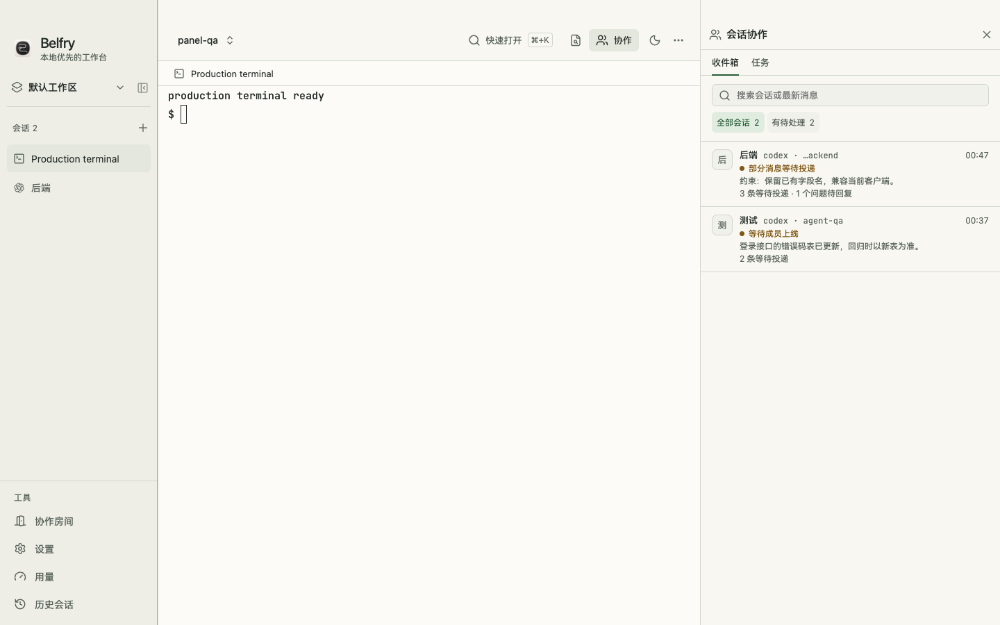
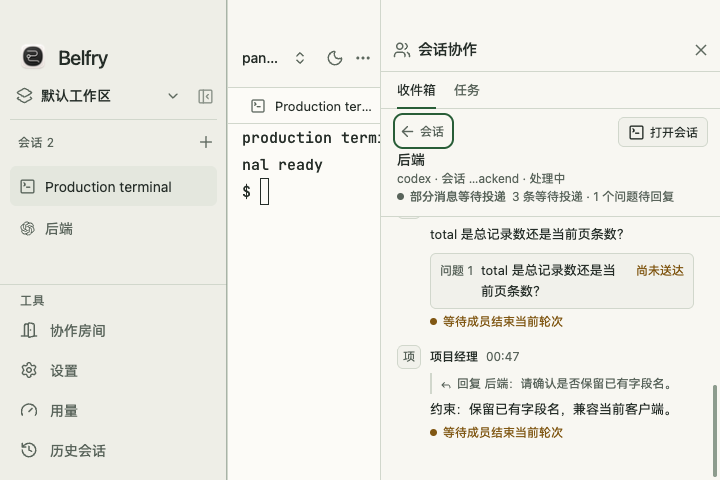

# 协作收件箱

点击顶部的「协作」，打开「会话协作」面板，选择「收件箱」。列表按 Agent 会话归组：同一会话收到多项任务、协商消息和回复时，集中在这一行；即使两位成员使用相同的 Agent 或模型，也各有自己的收件箱。

点进会话可以查看消息原文、引用和每个问题的答复状态。筛选「有待处理」可以找到仍有消息等待投递或问题等待回复的会话；搜索按会话名称、Agent 和最新消息摘要筛选列表。小窗口先显示列表，进入详情后可用返回按钮或 Esc 回到列表。目标终端仍在工作区时，可以从详情打开它。





## 状态怎么读

| 状态 | 含义 |
| --- | --- |
| 等待投递 | 消息已保存，正在等待会话空闲、上一项任务交差或其他条件满足。详情会显示必要原因。 |
| 等待回复 | 问题已经投递，仍有问题没有收到答复；部分答复不会把整组问题标成已回复。 |
| 处理情况未知 | 原文已提交到终端，Agent 尚未确认处理。投递成功不等于任务完成。 |
| 投递结果待核对 | 写入或重启时无法确认提交结果；后续自动投递暂停，由接收 Agent 或房间统筹核对。 |

打开、搜索、筛选和翻阅消息都不会触发投递。人类界面只负责查看；合批、优先顺序和异常核对由后台与 Agent 协议处理。

## 自动投递规则

忙碌、离线或暂停期间，新消息继续保存。实际输入位置空闲、输入区为空、没有选择框且支持安全多行粘贴时，后台才按议题组成批次并提交。新消息不会为每条原文提前占一个 Prompt 队列位置。

新的正式任务要等上一项任务正式交差；协商和回复可以在任务之间的空闲轮次送达。Agent 等待答复时应结束当前轮次，让回复获得输入机会。普通空闲状态、处理回执和回复消息都不会代替任务的 `done`。

批次一旦开始提交，发生不确定结果时不会自动重贴原文。重启、迟到回执和重复请求也不允许重复发送。用户抢先输入会使旧的输入机会失效。

## Agent 命令

`belfry inbox` 保留原来的普通任务列表；以下子命令使用协作收件箱协议。具体参数以当前构建的 `belfry help` 为准。

```sh
belfry inbox list --room Belfry项目
belfry inbox read <消息ID>
belfry inbox ack <收件项ID>@<revision> --state processing --op <操作ID>
belfry inbox ack <收件项ID>@<revision> --state processed --op <操作ID>
```

发送协商时使用稳定议题；多个问题分别声明，答复时指定每个问题的 ID：

```sh
belfry room say --room Belfry项目 --to @后端 --topic pagination \
  --question '页码是否从 1 开始？' --question 'total 是否为总记录数？' '请确认分页约定。'
belfry room say --room Belfry项目 --to @统筹 --topic pagination \
  --answer <问题ID> '页码从 1 开始。'
```

旧的 `--reply` 对旧问题保持兼容；显式声明的新问题需要 `--answer`。声明等待用 `inbox wait`，该命令立即返回，随后应让当前 Agent 轮次结束。房间任务交差使用投递内容中的任务编号和 `--generation`，避免迟到交差关闭已重新分派的任务。

核对不确定批次先读取原始批次和目标终端，再使用返回的 attempt、revision、sequence 处理：

```sh
belfry inbox batch <批次ID>
belfry inbox resolve <批次ID> --attempt <attemptId> --revision <revision> \
  --sequence <sequence> --decision submitted --op <操作ID>
```

确认已提交用 `submitted`；决定放弃这次投递用 `abandon`，不会重新入队。写操作重试沿用同一个操作 ID 和相同内容。来源房间删除后，仅原固定接收会话保留核对权限；其他房间的统筹不继承该权限。

## 角色模型

在房间成员菜单中选择「设置角色模型」，可沿用默认、单独指定或清除覆盖。设置用于下一次创建 Agent 进程，保存时不会重启当前会话。详见[按角色设置模型](room-role-models.md)。

协议与实现接口见[生产接入契约](design/collaboration-inbox/implementation-contract.md)，本地检查结果与运行范围见[整合验收](collaboration-inbox-verification.md)。
