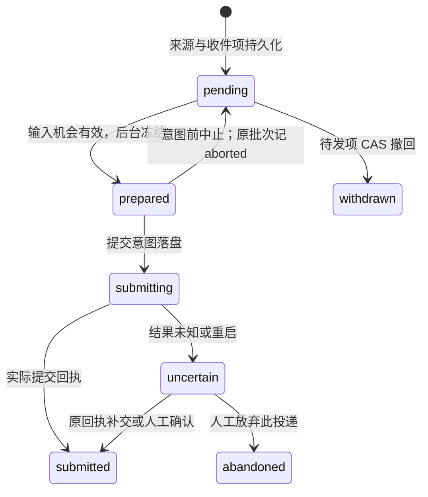

# 收集、取批与投递协议

## 持久化边界

首版建议扩展现有 TaskBoard 的版本化存储，统一持久化普通任务、InboxEntry、DeliveryBatch、TaskSlot、回执 outbox 和去重键；房间原文、问题答复及房间任务仍以 RoomStore/账本为来源事实。这里只建议后继存储版本，不执行格式升级。

1. 发信/任务操作先在来源事务中提交原文、具体接收身份和 outbox。**暂停时也创建持久收件种子**，只是暂不投递。只有落盘成功才能返回已受理。
2. 后台按 `(sourceEventId, recipientId)` 幂等补入统一收件箱。重复泵送不刷新 receivedAt/enqueueSeq、不复活终态；未补入的源 outbox 在只读视图中按同一键显示“已保存，等待排队”，不能消失。准备批次前必须补齐相关来源状态。
3. 选中项、批次精确 payload/hash、占位和序号在同一调度事务提交，失败不发布内存状态。新批次不得跨来源存储范围混拼。
4. 回执先写统一存储，再幂等投影回房间 `deliveredTo`/outbox；投影失败只补投影。清理任何中转项前保留永久去重/终态依据，不能因旧 outbox 快照再次发送。
5. 房间任务 done/reopen/assign、暂停和成员变更按源 revision 传递；旧事件不能覆盖新状态。prepare/begin 在固定锁序（RoomStore→调度存储）内复查来源，相关源操作也走这一协调边界；跨进程继续用文件锁和 revision 冲突拒绝陈旧写入。等待 IPC/PTY 时不持有这些锁。

这里没有假设两个文件或 PTY 能原子提交：来源与调度靠 durable outbox 和幂等补偿；实际写入与回执之间的缺口只能显示 uncertain。任务结束事件暂未投影时宁可继续显示等待，不能提前放行下一任务。

未来启用新协议时，每个会话必须只有一个投递 owner：先停用旧 fetch/claim 路径，再接管新收件箱。旧内存队列只有证明无提交意图且不会再写入，才可恢复 pending；否则保留不确定状态。旧 submitted 不回放，已 active 的房间任务及普通 dispatched 任务都须重建占位。本轮不执行这项切换。

## 输入机会与冻结点

界面轮询只读收件箱。每个 `(projectRoot, tabId)` 只有一个待处理标志/唤醒提示，来信仅增加 revision 和计数；**不为每条原文提前创建 PromptQueueItem 或调用旧 claim**。提示丢失可从持久 pending 重建。

运行时通过以下四步发送；首版只使用现有 Agent 的安全输入边界，不假定所有模型都支持运行中插话。

| 步骤 | 运行时与后台动作 |
| --- | --- |
| 1. offer | 实际 Prompt/终端运行时确认 target 已注册、项目/会话代次匹配、running、可接收本轮输入、输入区空、无选择/权限提示、无先到的用户输入及其他在途/不确定输入；保留短暂本地发送位置。产生 `ownerId + targetEpoch + offerId`，绑定当前输入代次，建议有效 5 秒。名册 canReceive/idle 本身不能代替此证明。 |
| 2. prepare | 运行时带 offer 调后台；后台锁内校验目标、暂停/暂缓、任务占位、来源 revision、容量和顺序，从此刻已提交 pending 选择。原子写入不可变批次及短租约，返回 batchId、attemptId、entryIds、精确 payload/hash；这是唯一冻结点。未满足条件就返回 blocker，不创建批次。 |
| 3. begin | 运行时再次确认 offer 对应输入位置仍可用，带 lease、batch revision 调 `begin_submit`。后台重查硬门控后持久化 submitting/sequence，成功回应后才允许 `sendText`，且同一运行时用 writeOnce 标志保证只调用一次。任何异步间隙出现新用户输入，都不能把该批再排到普通 Prompt 队列等待。 |
| 4. receipt | 只用实际 Prompt observer 回执记 submitted。回执丢失只重发相同 `(batchId, attemptId, sequence, phase, payloadHash)`，不重新 submit。提交后下一批仍需新的输入机会；输入清空和轮次变化只解除输入占用，不释放 TaskSlot。 |

Agent 声明议题、问题、优先级等意图；后台有输入机会时自主走这条路径，不等人类点击发送。Agent 读取的候选仅对应某 revision，不接管消息；prepare 使用届时最新合格集合。Agent 不能绕过公平顺序、批准、当前任务或硬门控，也不能以自拟摘要替换原文。

ownerId/targetEpoch 在终端注册时通过扩展现有会话同步绑定并撤销旧 owner。所有自动输入和用户输入共用输入位置/代次仲裁；最终 PTY 写入点也检查本代次。意图前用户输入到来则让出位置并中止准备，意图后无法证明未写则 uncertain，不能仅在 beforeSend 检查一次就忽略后续输入变化。

prepare 已成功但响应丢失：同一 operationId 查询/重试返回原批次，不能另取一批。租约过期且**从未有提交意图**时，后台可将原批次标 aborted、原项回 pending，保留原 enqueueSeq；迟到 begin 因租约/epoch 被拒绝。原批次内容继续可查，不修改后再复用。

begin 请求结果未知、进程重启或可能碰过 PTY 后，不能凭租约过期退回 pending；首版保守进入 uncertain，禁止自动重投。只有明确在提交意图之前拒绝，才可安全退回。这样可能增加人工核对，但不以重复输入换取“自动恢复”。

submitted、withdrawn、abandoned 均不自动再次进入 pending。迟到回执须匹配原 attempt/epoch/hash；重复回执幂等，旧 sequence 不回滚新状态。人工决定也保存原 revision/sequence；此后迟到的真实提交证据只追加审计事实，不撤销放弃决定、不重新发送、不宣称任务完成。

## 新任务与协商的门控

| 内容 | 放行条件与释放 |
| --- | --- |
| 新任务 | 一个会话最多一个自动投递任务占位。prepare 时即保留 TaskSlot，submitted 后继续占用；room task done、普通 done/fail，或有权操作者明确取消/归档当前任务后才释放。意图前安全中止可释放本次预留。 |
| 当前任务中的协商 | 不检查“上一任务交差”；等安全输入机会即可。相同议题内尚未合格的新任务不能被顺带送出。 |
| 等待答复 | answers/replyTo 匹配接收者显式 WaitLink 时优先；即使双方都有 active 任务也可发送。回复只解除相应等待，不结整个任务。 |
| 用户停止 | 先通过已有宿主控制能力停止后续调度/按用户操作中断终端，同时记事件；不能作为普通消息排在工作后面。暂停房间本身不冒充“当前工作已停止”。 |

保留现有批准、同项目、成员权限和任务 blockedBy 约束。后续任务只是 planned，不因排队就占住当前槽；新任务批次只含一份任务分派。begin 复查允许本批自己的预留，不将其当成“上一任务”。任务 start/reopen/reassign 与占位同步，重开视为新的任务生命周期；旧 done 事件不得释放新占位。已有多个 active 任务时，内部保留全部 `activeTaskRefs`，等其明确结项，不猜哪个才算当前任务。

`done` 发生时终端可能仍在说话：只释放任务门，仍等新的安全输入机会。人工放弃 uncertain 投递只结束运输核对，不自动取消原任务或清掉任务占位；取消任务需走原有正式操作。

等待协商的 Agent 应声明 WaitLink 并结束当前轮次，让出输入机会；不能一直阻塞在工具 wait 中又期待不支持插话的终端收到新输入。首版只消除任务门造成的相互等待，不承诺打断权限框或任意运行中的模型。没有显式 WaitLink 的普通回复仍可按普通协商处理。

## 顺序、容量与持续来信

- 普通协商沿用 2.5 秒安静窗口，增加硬上限：`dueAt = min(最早待发接收时间 + 5s, 最后来信时间 + 2.5s)`。有旧积压时输入机会出现就可取批，不能因一直来信无限顺延；匹配 WaitLink 的答复不等防抖。时间值为首版建议值。
- 先过滤不可投递项，再按“匹配等待的答复 → 显式 high → 普通”选锚点；同级按原 enqueueSeq。同一会话每连续两次优先批次后，下一次机会必须服务最老的普通合格项；计数持久化，在 begin 提交时推进。主动暂缓、暂停、任务门阻塞和仅知会不属于合格项。
- 锚点必须入批；余量填入同来源/同议题/同接收者最早的合格协商项，并按原序号展示。任务分派单独成批，不能夹带尚待交差的新任务。新来内容不修改批次，且优先/恢复操作不重置旧项年龄。
- 建议每批最多 **20 条原文、32 KiB 最终 UTF-8 输入、32 个展开问题**，包含协议头尾及引用说明；附件只带既有文件引用。达到任一上限就截止，Agent 的批次结果包含本批数量和剩余数量。Agent 候选估算不是容量承诺，后台按实际编码再次计算；人类列表只显示必要的待发数量。
- 单条超长或问题过多时使用 `contentMode=reference` 的有界原文入口批次，带原消息 ID/hash、问题总数和分页读取入口；原文及全部问题不截断、不悄悄当作已处理。投递的是入口，UI 明示；ack/answers 仍需指定原项/问题。该条不能永久堵住后续消息。
- 同议题回复引用窗口外原文时带稳定引用，原问题仍可读。单独的 fyi 不自动唤起，只随同议题有操作意义的锚点送入；成员主动查询不触发终端补发，显式 processed 的 fyi 不再搭载。不能为了清空计数生成“收到—谢谢”循环。

因此，只要接收者持续提供输入机会，且一条普通消息持续合格，其前面的有限旧消息就会逐批被服务；后来高优先消息不能永久插队。没有输入机会、被主动暂缓或尚欠任务交差时不作等待时长保证。

## 操作竞争和恢复

| 情况 | 确定行为及界面解释 |
| --- | --- |
| 调整优先/暂缓先于 prepare | 同一锁内读到新 policyRevision；优先参与排序，暂缓项不入批。 |
| prepare 已冻结后调整策略 | 优先只影响后续待发；返回 affectedPendingCount 和 unaffectedBatchIds。暂缓/暂停会在 begin 再检查，意图前可中止整批，保留不可变旧批记录。 |
| 撤回与 prepare 竞争 | 撤回显式 entryIds+各自 revision，且全部仍 pending 才全成；prepare 先赢则返回 CONFLICT，无部分静默撤回，刷新后重新选择。撤回不删除房间原文。 |
| begin 先于暂停/暂缓 | 已跨提交边界的批次可能送达；暂停只保证后续，显示“后续投递已暂停，当前提交待确认”。不能谎称撤回成功。 |
| 多窗口、旧 target、迟到 ready | 后台同会话互斥、owner/epoch/lease fencing，只一个批次；旧运行时不能因重试获得新的写入许可。 |
| 离线/前端卸载 | pending 继续持久化；意图前 prepared 可中止。submitting 转 uncertain，接收者整条自动输入通道暂停，避免后续内容覆盖残留输入。 |
| 重启 | 先校验存储版本/revision，补 source/receipt outbox，再重建提醒；prepared 无意图则中止重排，submitting→uncertain，submitted/withdrawn/abandoned 不重投。无活 target 时显示离线。 |
| 成员离开、换绑、项目变化 | pending 保留并阻塞为 target_changed；不投给同名替补。已投递事实继续绑定旧身份；重新指定接收者必须产生新的显式收件记录并链接原记录。 |
| uncertain 人工核对 | 先按稳定 tab 定位终端，再以原 attempt/sequence/revision 确认提交或放弃。冲突必须刷新核对；没有“重试发送”按钮，人工决定后仍需新的安全输入机会。 |
| 存储错误/未知版本 | 不发送、不清空收件箱；返回明确加载/保存错误，保留上次已提交快照及操作错误。 |

本协议的上限是持久化、可解释、避免自动重复写入；它不提供外部模型“恰好处理一次”的保证。
