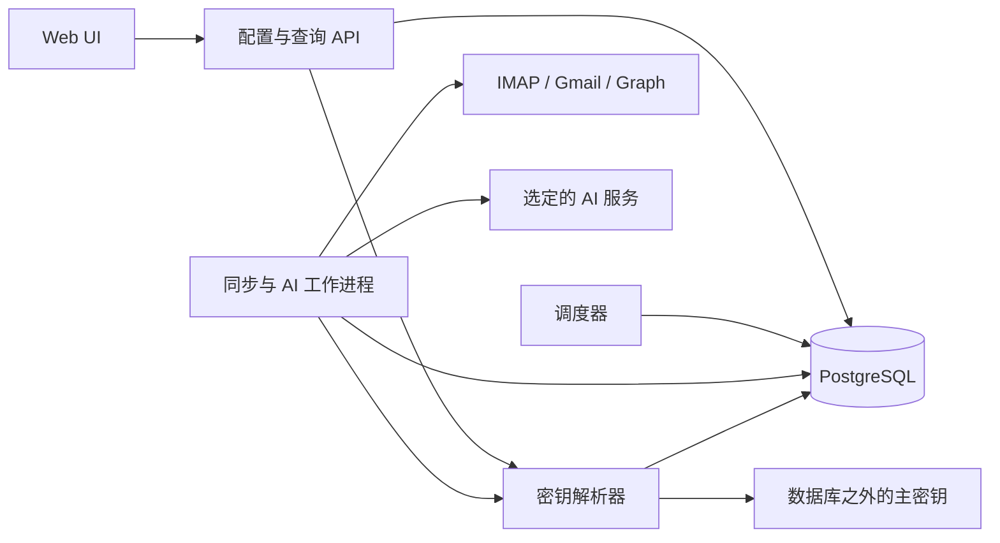

# Mail AI Assistant — 后端设计

状态：可评审设计稿 v0.3；未创建服务、生产代码或真实连接。
负责人：后端开发工程师。API 字段与状态的唯一基线为 [api-contract.md](api-contract.md)。
范围基线：[brief.md](brief.md)、[delivery-plan.md](delivery-plan.md)。

## 1. 已选定的实现方向

采用独立常驻后台服务与响应式 Web UI，不依赖 Belfry 进程、浏览器定时器或桌面窗口。建议首版使用 **Python 3.12、FastAPI、Pydantic 2、SQLAlchemy 2/Alembic、PostgreSQL 16**。API 与调度/工作进程分别启动，共用数据库；以 PostgreSQL 持久任务表与行锁实现队列，M1 不引入 Redis、Celery 或额外消息中间件。

这一选择用于承载事务内的“邮件 + AI 任务 + 同步进度”提交，以及重启后的工作恢复。IMAP 使用标准库 imaplib 放入有上限的线程池；HTTP 提供方使用有连接数限制的异步客户端。与现有 Belfry 的技术栈无耦合要求，实际项目与部署文件将在后续实现阶段建立。

| 阶段 | 明确交付范围 | 延后项 |
| --- | --- | --- |
| M1 | 单用户；数据模型支持多邮箱，但只承诺验证一个 TLS/993 IMAP Inbox、一个摘要任务和一个选定 AI 适配器；配置/测试、正文入库、定时及手动同步、结果/运行历史、去重/重试、受控 UIDVALIDITY 恢复 | Gmail/Graph 实接、其他模板、复杂筛选 |
| M2 | 经验证的多邮箱、六种任务模板、绑定筛选、Gmail/Graph 官方授权与增量同步、可编辑回复草稿 | 任意服务商兼容承诺、群组/共享邮箱全面覆盖 |
| M3 | 显式历史导入、附件文字/OCR、带时区的定期汇总报告、外部输出、批量重跑 | 自动发送邮件须单独立项与授权，不能由邮件内容启用 |

首版默认：每 300 秒检查；只处理首次激活之后收到的 Inbox 邮件；结果留在应用；附件只展示元数据。`deployment_default` 是部署时选择并实现的单个 AI 适配器别名，不能把可填写 baseUrl 解释为所有模型协议均受支持。

## 2. 组件边界

| 模块 | 责任与边界 |
| --- | --- |
| API / configuration | 校验请求、认证/CSRF、ETag、幂等键；只入队和查询，不在请求线程中抓取整批邮件 |
| connection / authorization | 邮箱测试、AI 测试、OAuth 会话与续期；固定账户及凭据目标，不向前端返回 secret |
| mailbox adapters | 解释服务商身份、文件夹与游标；只读远端；返回带下一页/最终游标的规范事件；不自行提交数据库进度 |
| ingestion / normalization | 解析 MIME、选择正文、产生安全纯文本和附件元数据；身份去重、入库、匹配绑定、生成 AI 运行 |
| scheduler / dispatcher | 到期策略合并、持久任务领取、租约、背压、自动重试与宕机恢复 |
| AI adapters / validation | 按固定任务/配置版本组装输入，调用模型，校验结构化输出；没有执行邮件指令的工具权限 |
| result / draft | 不可变模型输出、版本来源、用户编辑草稿、保留期与查询；复制由浏览器完成 |
| observability / retention | 脱敏运行记录、队列和时延指标、按政策清理内容，保留去重墓碑 |

统一 MailboxAdapter 的逻辑操作为 testConnection、startSync、fetchPage、fetchContent、recoverCursor；结果含 source identity、receivedAt、folder/label 变化、分页 continuation 与稳定 checkpoint。AI ProviderAdapter 暴露 capabilities、testConnection、generate；generate 的输入含 runId、taskVersionId、configVersionId、规范正文和输出 schema，返回原始输出、可用的用量与请求标识。适配器统一报告鉴权、限流、临时网络、游标失效和永久格式错误，核心流水线不判断 SDK 异常字符串。

## 3. 数据实体、约束与索引

数据库使用 snake_case，API 映射为 camelCase。主键采用应用生成的不可解析 ID；所有时间列为 timestamptz。外键禁止级联删除仍被运行/结果引用的任务版本、服务版本和邮件身份。敏感正文与密钥字段在表中保存密文或引用。

| 实体 / 表 | 主要字段 | 必需约束 / 索引 |
| --- | --- | --- |
| AppSettings | 单行设置、revision、显示时区、默认间隔、保留期、cleanup_effective_at | 单行主键；设置修订用于并发更新 |
| MailboxConnection | provider、账户身份摘要、连接参数、credential_binding_id、connection_state、revision、最近检查/成功/错误 | 同适配器的规范账户键唯一；账户键用带密钥摘要。实际身份未验证时不宣称账户已连接 |
| SyncPolicy | mailbox_id、enabled、interval_seconds、folders、activated_at、next_due_at | mailbox_id 唯一；索引 (enabled,next_due_at) |
| MailboxFolder | mailbox_id、role、provider_folder_id、展示名 | M1 unique(mailbox_id,role)，role=inbox；真实 provider folder ID 不用展示名代替 |
| FolderSyncState | folder_id、generation、checkpoint_revision、uid_validity、processed_uid_high_water、加密 API checkpoint/page cursor、recovery_anchor | folder_id 唯一；更新同时校验 generation、revision 与租约 fencing token |
| MailMessage | mailbox_id、first_sync_run_id、received_at、ingested_at、content_state、规范内容密文、附件元数据密文、normalizer_version、比对指纹 | 索引 (mailbox_id,received_at,id)、(mailbox_id,ingested_at,id)、(first_sync_run_id,id)；不以 Message-ID 或未读标记唯一约束 |
| MessageSource | mailbox_id、folder_id、source_kind、identity_value、message_id 或 recovery_item_id、remote_state、首次/最近观察时间 | unique(mailbox_id,source_kind,identity_value)；message/recovery 二者恰有一个；来源键永久保留到显式删除连接数据 |
| MessageFolderMembership | message_id、folder_id、provider labels、remote_state | unique(message_id,folder_id)；原生 API 的一封邮件可有多个来源标签但只有一个规范邮件 |
| RecoveryItem | mailbox/folder、generation、暂存规范内容密文、候选 message IDs、reason、status、决定与时间 | 索引 (mailbox_id,status,created_at)；一次决定，幂等关联；有界容量 |
| AIService | name、active_config_version_id、revision、当前配置的连接健康 | 引用当前配置版本；**没有服务级“通用最新密钥”供旧版本读取** |
| AIServiceConfigVersion | service_id、version、adapter_id、规范 base_url、default_model、credential_binding_id、健康/测试摘要、视图 revision、创建时间 | unique(service_id,version)；配置及凭据绑定目标不可变，凭据/健康摘要可变 |
| CredentialBinding | owner type/ID、配置版本/账户、audience、active_secret_version_id、revision、revoked_at | 目标受服务端校验；一个配置版本固定一个绑定；密钥轮换只发生在该绑定内 |
| CredentialVersion | binding_id、密文、nonce、主密钥版本、创建/撤销时间 | 密文 AAD 包含 binding/目标；无公开 GET；OAuth refresh 采用绑定行锁与 CAS |
| AITaskDefinition | name、enabled、current_version_id、revision | current_version 属于本任务；停用不修改历史版本 |
| AITaskVersion | task_id、number、模板/指令、匹配条件、模型设置、service_config_version_id、输出 schema、prompt/matcher 版本、定义 hash | unique(task_id,number)；定义不可变；不在 worker 中按 task_id 重新读取最新版 |
| TaskBinding | mailbox_id、task_id、enabled、effective_from、revision | unique(mailbox_id,task_id)；索引 (mailbox_id,enabled) |
| SyncRun | mailbox_id、status、phase、trigger、累计已提交计数、重试时间、租约/fence、错误 | 每邮箱只有一个 queued/running/waiting_retry 运行的部分唯一索引；领取索引 (status,next_attempt_at,created_at) |
| AITaskRun | message_id、task_version_id、binding_id、固定配置/输入 hash、status、attempt、重试时间、租约/fence | unique(message_id,task_version_id)；领取索引同上；索引 (mailbox_id,created_at,id)、(task_id,status,created_at) |
| RunAttempt | run kind/ID、attempt number、起止时间、外部调用状态、脱敏错误、实际 credential_version_id、usage | unique(run_kind,run_id,attempt_number)；记录未知调用结果，不伪造零成本 |
| Result | ai_task_run_id、message/task/version 来源、template、schema version、不可变输出密文、warnings、status、revision | ai_task_run_id 唯一；按 created_at/id、mailbox_id/created_at/id、task_id/created_at/id 查询索引 |
| ResultDraft | result_id、当前 subject/body 密文、edited_at | result_id 唯一；与 Result.revision 同事务更新；不覆盖模型原始 output |
| ConnectionTest | target type/ID、固定配置/凭据版本、status、检查项、错误、时间 | 同一目标/配置只有一个未结束测试；有领取/创建时间索引 |
| IdempotencyRequest | 用户/方法/路径/键、请求体摘要、响应资源及状态、过期时间 | unique(user,method,path,key)；过期索引；不保存原始含密钥请求体 |

队列容量采用短事务中的预算行锁与活动运行计数；不能由各 worker 先读计数再分别入队。M1 不建立 ReportDefinition 执行表；M3 另行定义范围、时区、计划和来源任务，避免把跨邮件汇总伪装成一次单邮件任务。

查询投影（API v0.3）：结果页先按 created_at/id 取 limit+1 个 Result，再在有界批量查询中关联 MailMessage、MailboxConnection 与固定 TaskVersion，返回 ResultSummary 的邮件/任务/邮箱摘要，避免逐行 HTTP/数据库查询。只有摘要所需头部在授权查询中解密，正文仍按需读取。游标签名绑定调用者、筛选、limit 与排序键，15 分钟有效；不提供跨请求事务快照或精确总页数。RecoveryItem 详情把正文可用性、身份判定状态和 allowedActions 分开，所有解决动作仍在事务中重新校验。

### 3.1 来源身份

- IMAP：规范文件夹 ID + UIDVALIDITY + UID，共同构成 identity_value；UID 使用数值类型而非消息序号。M1 固定 Inbox，所以文件夹路径重命名的扩展问题不会混入首版。
- Gmail：账户范围的 message.id；historyId 是同步水位，不是邮件身份；threadId 不能用于合并整封邮件。
- Graph：账户范围、区分大小写的 immutable message ID；每个相关请求均设置 `Prefer: IdType="ImmutableId"`。移动到 archive mailbox 或导出再导入可能改变 ID，不能承诺跨邮箱不变。
- Message-ID 仅作候选匹配依据，可能缺失、重复、被伪造。跨连接不合并邮件；两个邮箱收到同一内容是两个独立处理范围。

## 4. 首次激活、普通增量与原子提交

`activatedAt` 是服务器在首次启用/手动同步时写入的不可变边界。自动处理规则为服务商的 receivedAt >= activatedAt，且属于所管 Inbox；receivedAt 来自 IMAP INTERNALDATE、Gmail internalDate 或 Graph receivedDateTime，不使用发件人 Date 头，不使用已读/未读条件。来源时间缺失或非法时隔离并显示原因。

暂停/重新启用、凭据更新、重试、UIDVALIDITY 恢复都不重设此边界。边界之前的邮件后来移入 Inbox 仍属于历史导入。邮件在轮询前已从远端永久删除时，通用拉取方案无法恢复未曾观察到的正文；界面不能承诺完整邮箱归档。

### 4.1 一页数据的提交顺序

1. 工作进程领取 SyncRun 与邮箱租约，读取 generation/checkpoint_revision；在事务外获取一页远端变更和所需正文。
2. 将正文/元数据规范化，得到候选 MailMessage、来源键及下一页/稳定游标。网络超时不当成“该邮件不存在”。
3. 开启短事务，锁定同步状态和队列预算；确认租约 fence、generation、checkpoint_revision 仍与读取时相同，校验新增邮件将生成的任务数量未超容量。
4. 幂等写入 MessageSource、MailMessage 或含完整可保留内容的 RecoveryItem。远端确认已经删除的对象写 unavailable 墓碑；超限/不可解析邮件写明确失败记录和受限原始正文片段，不假装成功处理。
5. 对首次入库且 available 的邮件读取此刻启用的绑定及任务版本快照，匹配条件，写 AITaskRun。唯一键冲突返回已有运行；每个任务独立，不能因一个服务失败取消其他任务。
6. **在同一事务内**推进已完整处理的一页的 checkpoint、累计运行计数；提交后工作进程才可继续下一页。只有所有候选都已持久化或有可见的持久处理结论时，才允许跨过该页。

游标不是“最大一个成功邮件的 ID”；不能越过页内尚未处理的错误。采用 generation/revision 的比较更新确保重复页或过期 worker 无法重复累计计数。事务失败则邮件、AI 运行、游标一起回滚。事务提交后即使进程未发出唤醒通知，AI worker 也能从数据库轮询发现工作。

空页提交成功、更新上次成功及下一次计划检查，记录 scanned/persisted=0。暂时的队列满进入 waiting_retry/backpressure，暂存页可丢弃后重取，但 checkpoint 不提前推进；不存在“先标已处理、以后想办法再补 AI”的隐藏丢失窗口。

## 5. 服务商差异与恢复算法

| 项目 | 通用 IMAP（M1） | Gmail API（M2） | Microsoft Graph（M2） |
| --- | --- | --- | --- |
| 授权 | TLS/993，用户授权的密码/应用授权码；后续按服务商增加 OAuth | OAuth，优先只读邮件 scope，支持 token 续期/撤销 | OAuth 委托 Mail.Read 与所需续期 scope；租户授权政策适用 |
| 文件夹 | EXAMINE Inbox，UID 空间独立 | 标签模型，首版筛选 INBOX | 每文件夹一条 messages/delta 链，先解析 Inbox 的真实 folder ID |
| 进度 | UIDVALIDITY + 已完整处理的 UID 高水位 | 不透明 historyId；遍历所有分页后提交稳定水位 | 不透明 nextLink/deltaLink，最终 deltaLink 才代表本轮完成 |
| 只读行为 | BODY.PEEK 读取指定正文部分，不 STORE flags | 不修改标签/已读，不调用发送接口 | 不 PATCH 消息/已读，不申请发送动作 |
| 恢复 | 新 epoch 下受控扫描；无稳定身份时人工确认 | history.list 返回过期范围 404 时重新扫描并收敛增量 | 410 或 syncStateNotFound 等失效信号时重新建立文件夹 delta |
| 覆盖边界 | 服务商须开放 IMAP，且账号/管理员允许；不同登录方式逐个验证 | API 配额、OAuth 应用配置与审核可能影响实接 | M2 先验证个人/组织用户自有邮箱；共享邮箱、应用权限、归档邮箱另行验证 |

### 5.1 IMAP 初始化与正常同步

- 连接后使用 EXAMINE 获得 UIDVALIDITY 与 UIDNEXT；上界固定为本轮观察到的 UIDNEXT−1，不把之后到来的邮件混入未完成页。
- 初始化时以 activatedAt 所在日期之前一天作为宽松 SINCE 日期，检索上界以内候选；再用带时区 INTERNALDATE 精确过滤。这样不会漏掉“用户启用之后、首次读取 UIDNEXT 之前”到达的邮件，也不会把当日早些时候的邮件误当新邮件。
- 完成上述初始化范围后保存 UID 水位。普通运行处理 `(processed_uid_high_water, observed_upper_bound]` 内的 UID；若下界大于上界不发送反向范围。UID 可以有空洞，不假设连续编号。
- 先取头、BODYSTRUCTURE 与受限正文部分；选 text/plain，缺失时把 text/html 转为安全纯文本。附件不作为 BODY.PEEK 内容目标；读取不设置 Seen 标记。
- 被 EXPUNGE 且再次核对确已不存在的 UID 记 unavailable/tombstone。网络失败重试，永久 MIME 问题隔离，不能把这两者当成空收信。

### 5.2 UIDVALIDITY 改变

1. 保留旧来源键与规范邮件，递增 FolderSyncState.generation，撤销旧 fence 对新进度的写权。丢弃旧 UID 水位，phase 切 recovering。
2. 在新 epoch 对**仍位于 Inbox 且 receivedAt 不早于原 activatedAt**的邮件分批扫描；每次最多 100 个候选，继续使用页事务。不能只按“最近五分钟”扫描，否则可能漏掉停机期间邮件。
3. 若服务商已验证支持 UID 之外稳定的邮件对象 ID，可据此关联旧 MailMessage；同一原生身份绝不生成第二组同版本任务。
4. **首版通用 IMAP 无这种稳定 ID 时采用保守恢复**：快照中无法证明身份的条目全部持久化为 RecoveryItem，提供 0/1/多个候选，不自动推断它是新邮件或旧邮件。候选由 Message-ID、INTERNALDATE、完整已取正文与稳定头部/附件元数据的指纹联合给出；指纹只是建议，不能证明两个物理投递相同。
5. 用户通过 API 选择关联已有邮件或保留为独立邮件。前者新增来源别名，不重新生成结果；后者是明确的新邮件判定，再按当前启用绑定生成任务。多条完全相同的邮件必须保留可区分的数量，不能用内容 hash 一刀切合并。
6. 暂存正文与来源身份已经持久化后可推进恢复扫描进度；扫描完成但有待判定项时本轮为 partial，错误为 DEDUP_REVIEW_REQUIRED。新 epoch 上界之后的新到邮件可继续普通增量，待判定项单独保留。容量满时恢复扫描暂停，不能丢弃待判定项。

这能保证未确定的恢复项不产生重复可见结果，但会增加极少数 UID 重置事件后的人工处理。普通 IMAP 无法在任意服务器重写内容/身份后保证完全自动且无损的跨 epoch 合并；设计明确暴露这一边界。

### 5.3 Gmail 历史游标失效

- 正常读取 history.list，按消息事件与当前 INBOX 状态取所需内容；只变更已读/标签的事件更新来源状态，不重新执行同版本任务。historyId 不连续，不做加一运算。
- 初次同步或失效恢复时，先取得当前历史锚点 H0，再分页扫描当前 INBOX 的候选邮件、按 receivedAt 精确筛选并入库；随后从 H0 排空期间的历史变更，最后才把完成的历史水位设为稳定 checkpoint。
- 每页保存独立恢复进度；历史或分页游标在扫描中再次失效时重启受控扫描，继续按 Gmail message.id 去重。保留已保存邮件与 AI 运行，不清空数据库“从零开始”。
- 对已知 ID 的 messages.get 确认 404 可记录远端删除；history.list 因历史范围过期的 404 则触发恢复。两者不能映射为同一处理。历史窗口长度不硬编码为固定天数。
- 正文读取时仅保留所需正文部分，附件只保留元数据，不调用附件内容接口；若响应附带附件 data，不持久化、不送入 AI。

### 5.4 Graph delta 失效

- 每个文件夹独立维护链；使用 `Prefer: IdType="ImmutableId"` 获取邮件，ID 大小写保留。nextLink/deltaLink 是不透明的完整 URL，不拆 token、改查询参数或自行拼接下一页。
- 每页内容与下一页指针同事务提交；最终页面的 deltaLink 成为下一轮稳定水位。分页重放是允许的，所有新增/更新/删除事件都必须幂等。
- 收到 410 或服务商明确的 syncStateNotFound 时从新的文件夹初始 delta 开始，完整排空页面，以原 activatedAt 过滤业务输入，用 immutable ID 与已有数据对账。首次/恢复枚举也遵守容量和工作预算。
- 不使用 created-only delta，因为需要知道已删除/移出对象；`@removed` 更新来源状态，不删除本地已经生成的结果。
- Outlook delta 的有效期与服务端缓存有关，不套用目录对象的“七天”规则。返回 URL 必须匹配 Graph 适配器固定的受信 API 地址，再附加 token；不能跟随任意主机的链接。

## 6. AI 任务、版本与结果唯一性

任务定义描述“做什么”，TaskBinding 描述“哪些邮箱的新入库邮件交给它”。每次首次持久化邮件时固定当时启用的 taskVersionId；保存绑定不追溯旧邮件。定义的模型、指令、匹配条件、schema 或模板改变时生成新版本；任务改名、启停不生成执行版本。

每个版本保存模型/配置版本、提示词模板版本、匹配器版本、输出 schema 和定义 hash。已有排队任务不能因代码升级换用一份不同的系统提示词；升级提示词应形成新任务版本/明确迁移。worker 领取后固定输入 hash、模型配置与实际凭据版本，便于审计。

### 6.1 重试和重跑

- AITaskRun 的逻辑键为 `(message_id, task_version_id)`，Result 对 ai_task_run_id 唯一。数据库唯一约束承担正确性，进程内去重只是优化。
- 重试沿用原运行与版本，在 RunAttempt 增加尝试；成功只写一个可见 Result。幂等键过期、worker 重启或同一邮件被再次同步都不能另建同版本结果。
- 用户选择新的任务版本重跑，才建立不同的逻辑运行及结果；UI 保留两版来源，不能把它呈现为同一条失败运行的重试。
- 外部 AI 服务可能已经执行，但服务在保存响应前崩溃。恢复时仍可能再次调用并产生额外费用；有提供方幂等能力时传稳定逻辑运行 ID，不能承诺远端 exactly-once。记录此尝试结果未知与 usage=null，保证的是本地可见结果唯一。
- 一个任务失败只影响自己的运行；邮件、其他任务和成功结果不回滚。自动重试预算用尽后保留失败记录与源内容，供用户单独处理。

### 6.2 输入和输出规则

输入仅含 subject、sender、receivedAt、安全 bodyText 和必要的任务配置；附件正文、远端图片、邮件链接内容不自动读取。邮件永远是数据区，不能改变系统指令、baseUrl、收件人、工具权限或模型选择。模型没有发送邮件、执行命令、读密钥或访问任意网络的工具。

M1 摘要输出固定 schema；后续模板遵守 API 中的 nullable 负责人/日期/字段定义。结构化提取 schema 由有限字段配置生成，拒绝远程 `$ref` 与代码。校验失败最多额外调用一次，再以 AI_OUTPUT_INVALID 结束；不补造信息以通过验证。模型可返回 warnings，但 warnings 不能把不符合 schema 的输出变为成功。

M2 字段提取采用 `fields: [{name,type}]`，1–20 个字段，名称为字母开头的 1–40 位字母/数字/下划线键，保留名称禁用且名称唯一；type 仅 string/number/boolean。完整输入 schema 与其他模板选项见 API 第 5.2 节。服务端生成包含全部键的 nullable 输出 schema，配置错误不产生任务版本，未知信息不转为默认值。

回复草稿的生成内容保持不可变；用户改动写 ResultDraft 并增加 Result.revision。复制使用当前编辑器内容，不创建 AI 运行或邮件发送动作。生成新版本结果不覆盖用户已编辑的旧草稿。

## 7. 调度、租约、重试与容量

| 设置 | M1 推荐值 / 语义 |
| --- | --- |
| 定时检查 | 默认 300 秒；允许 60–86400 秒；调度器每 5 秒检查到期策略 |
| 同步并发 | 每邮箱最多一个逻辑活动运行；全局最多 2 个正在访问邮箱的工作项 |
| AI 并发与速率 | 默认每 AI 服务 1 并发、每分钟 10 次；token 配额由适配器/部署进一步收紧，不保证满足任何提供方的全部配额 |
| 同步页与单轮预算 | 最多 100 封/页，最多 500 封或 120 秒工作时间/轮；完整页结束后 yield，hasMore=true；单页超时仍受请求/消息数上限保护 |
| 网络与测试超时 | 建连 10 秒，普通读请求 30 秒；连接测试总计 30 秒；AI 生成总计 90 秒 |
| 领取租约 | 120 秒，30 秒心跳；每次重领增加 fencing token；外部调用期间不持有长数据库事务 |
| 临时错误预算 | 每个自动重试周期最多 5 次尝试（含首次）；延迟上限依次为 30、60、120、240 秒，使用 full jitter；提供方 Retry-After 更长时遵从它 |
| 背压 | 每邮箱最多 1000 个活动 AI 运行，全局 5000；每邮箱最多 1000 个 pending 恢复项；达到限制等待 60 秒再检查，不消耗网络错误尝试预算 |
| 内容限制 | 规范正文 UTF-8 最多 1 MiB；正文部分传输设 2 MiB 限制；单次 AI 输入先设 32000 字符且必须满足所选模型的实际 token 上限 |
| 重复服务失败 | 同服务连续 5 次临时失败后熔断 60 秒，只允许一个探测工作项；鉴权失败等用户修复，不持续试密码 |

待运行表领取使用 `FOR UPDATE SKIP LOCKED` 加短事务；租约过期后重领**原逻辑运行**，不新建一条“恢复运行”。过期 worker 即使随后收到模型响应，也必须通过 fence 校验才能提交结果/游标；旧响应不能覆盖新 worker 的完成状态。调度器多实例也必须由唯一索引防重，不能只依赖“部署时只启动一份”的约定。

重启后扫描到期策略、queued/waiting_retry 任务以及已过期 running 租约。错过的定时点合并成一次补查，不重放每个五分钟槽；从持久游标取回仍可读取的全部合格邮件。下一计划时间从这次调度时刻加 interval 推算，已有运行时合并触发。积压超过单轮预算时以 continuation 运行继续，但暂停策略不继续自动排下一轮。

`retryable` 表示满足恢复条件后能否再次尝试，不代表可以无限自动重试。429 使用限速等待，不标记连接授权失效。永久错误、撤销授权、内容超限不会立即循环请求；UI 得到相应 error.action。熔断按目标地址/凭据 audience 隔离，旧主机故障不熔断新主机配置；服务整体的并发/速率上限仍作保守限制。手动重试重开有界尝试周期，总历史不清零。旧同步失败运行若已被更新运行接管，则以 RUN_SUPERSEDED 引导用户转到最新进度。

API 的 nextSyncAt 表示下次计划检查时间，waiting_retry 的 nextAttemptAt 表示当前运行再尝试时间，两者不能互相代替。队列/限流造成实际执行延后时界面显示 queued/waiting_retry，而不宣称调度准时完成。

## 8. 凭据、配置版本与目标主机绑定

### 8.1 避免“旧主机收到新密钥”

**每个 AIServiceConfigVersion 固定自己的 CredentialBinding。所有者是服务/配置版本；audience 是 adapterId + 规范化完整 baseUrl（scheme、host、有效 port、path 前缀）+ 账户/tenant 范围。** active_config_version_id 只是配置页面的默认选择，不是旧任务取密钥的入口。

例：配置 C1 指向 `https://old-ai.example.test/v1`，只绑定凭据 B1。用户把 baseUrl 改为 `https://new-ai.example.test/v1`，创建 C2 与新的空绑定 B2。C2 在为新目标配置凭据并测试前为 untested/credentialConfigured=false。排队中的 C1 任务仍只访问旧地址、读取 B1；不得读取 B2，也不能因 B2 已配置而自动替换 C1 的凭据。

- 每次密钥写入在 API 路径中明确给出 configVersionId，服务端从该版本推导目标；请求不能任意提供“把某个 secretRef 绑过去”。
- 轮换密钥只替换该绑定内的 active_secret_version_id。旧任务可使用**同目标、同配置绑定**的新密钥恢复授权；不会跨配置版本或跨目标寻找一把可用密钥。
- 新配置版本默认没有凭据。若只是同一 adapter/baseUrl 的模型默认设置变化，可通过显式 `reuseCredentialFromConfigVersionId` 复制凭据到新绑定；服务端必须校验 adapter、完整规范目标及账户/tenant audience 完全相同。变更主机、path、协议或端口时禁止复用。
- 老配置可继续工作，也可由用户撤销其凭据。撤销后该配置版本的 connectionState=auth_required，相关 AI 运行以 failed/AI_SERVICE_AUTH_REQUIRED 提示修复原配置或另存任务版本；运行状态不使用 auth_required，不能偷偷迁移到新主机。
- 发请求前解析固定配置，校验 binding audience，再取该绑定的凭据并形成鉴权头；RunAttempt 记录实际 credentialVersionId。严禁先取“service 当前密钥”再读取任务的旧 baseUrl。
- HTTP 不自动跟随重定向。Graph/Gmail 分页及刷新目标为适配器固定受信地址；自定义 AI 地址需部署允许，并在每次调用中校验 URL 与解析地址，不把 token 发往邮件内容里的地址、重定向目标或未授权主机。

AI 测试也固定 configVersionId 和实际凭据版本。如果测试期间配置/凭据发生变化，旧测试结果不能覆盖新配置的健康；其结果明确标记配置已变化，需要再次测试。邮箱测试/续期同样校验固定账户与凭据版本。

### 8.2 存储和轮换

密钥、OAuth access/refresh token 通过独立 CredentialVersion 加密保存，使用成熟库的 AEAD（如 AES-256-GCM），每条独立随机 nonce、关联绑定/目标的 AAD。主密钥不放数据库；推荐由只读密钥文件或部署秘密管理器注入，变量只存文件位置，例如 MAIL_AI_MASTER_KEY_FILE。备份不能只备数据库而没有可恢复的独立密钥备份流程。

OAuth token 绑定 provider、client、账户主体、授权 scope 与 mailbox connection。token 续期使用该绑定行锁和 CAS，避免两个工作进程互相覆盖新 refresh token；失效/撤销则转 auth_required。更换账户身份建立新 MailboxConnection，不能复用旧邮箱游标。

正文、主题、地址、模型输出、草稿和包含邮件片段的诊断载荷使用独立内容加密域；按类型/时间/账户筛选的最小元数据可明文索引。UI 按权限请求时才解密；首版不实现全文搜索。常规日志只保留对象 ID、状态、计数、耗时、标准错误码，不打印请求体、鉴权头、邮件内容、提示词或模型原始输出。

M1 API 仅接受 TLS/受信目标；URL 内不允许 userinfo、query 中凭据或 fragment。自托管内网/本地 AI 地址需要部署显式配置的目标许可，不能由一封邮件改变网络范围。服务配置页面的能力测试使用固定非邮件样本，并提示可能产生一次小额调用费用。

### 8.3 内容保留

推荐默认正文/头部和结果内容保留 90 天、运行详细诊断保留 30 天；原文从 ingestedAt、结果从 updatedAt 计算。实际期限在部署前确认。降低期限提供最早 24 小时后的 cleanupEffectiveAt，用户可在生效前调整。

清理内容时保留 MailMessage/Result 最小身份墓碑、任务版本引用、来源唯一键和指纹，避免重扫后把已处理内容重新送入 AI。未过期活动任务和待人工处理项暂缓内容清理，但受队列/存储预算限制并显示积压；不能无限增加隐藏队列。显式删除整个连接的数据时再执行独立、可审计的完整删除流程，首版不提供未经定义的级联删除 API。

已过期内容不可编辑或执行任务，API 明确返回 expired/CONTENT_EXPIRED。恢复时命中已有过期身份只关联墓碑，不借重扫自动延长保留期或重新生成结果。删除本地结果不删除远端邮件。

## 9. 可观测性与恢复验证

每次运行展示最近成功、下一次计划检查、已提交数量、当前阶段、尝试次数、下次重试时间与可操作错误。只在数据库健康且 worker 心跳有效时报告后台调度正常；Web 页面关闭不影响服务，主机挂起必然停调度。指标包括各状态队列长度、最老工作年龄、同步/模型耗时、提供方限流次数、待判定项数、租约过期数与 token 用量（未知保持 null）。

| 故障窗口 / 场景 | 设计要求与后续实现验收 |
| --- | --- |
| 抓取后、页事务前崩溃 | 旧游标未动；重抓同页，首次持久化邮件与任务 |
| 写邮件后、事务提交前崩溃 | 邮件、任务和进度共同回滚，无半提交 |
| 页已提交、worker 唤醒前崩溃 | 数据库队列保留工作；重启轮询继续 |
| 同步重复触发/重新领取 | 活动运行唯一；来源键及任务键无重复结果 |
| 模型已响应、结果未提交时崩溃 | 可能重复远端付费调用，但本地单一可见结果；未知用量显式记录 |
| 旧 worker 超时后恢复 | fence 不匹配则不能提交，不能覆盖新领取者 |
| UIDVALIDITY 重置 | 新 generation 分页扫描；无原生稳定身份的条目进入人工判定，不静默合并 |
| Gmail/Graph 游标过期 | 有界重扫、原生 ID 幂等、原 activatedAt 保留 |
| 一封邮件的多个任务之一失败 | 仅失败任务重试，其他结果持续可读 |
| 断网、限流或队列满 | 状态、等待时间与上限明确；checkpoint 不越过尚未持久处理的页 |
| 新配置更换 AI 目标主机 | C1 调用始终只用 B1；B2 不得出现在旧主机、重定向或旧任务的请求中 |
| 草稿被两个页面编辑 | 第二个旧 revision 写入返回 412，原模型输出与用户输入均不被静默覆盖 |
| 读/未读变化、空收信 | 均不构成新任务触发条件；空收信是成功且计数为零 |
| AI 没有明确负责人/日期 | 对应字段为 null；无推测值冒充提取事实 |

实现阶段对适配器使用脚本化假服务/固定响应验证状态机，故障注入验证事务和租约；收到授权后才针对代表性真实账户验证。模拟原型和设计自查不能代替这些实现验收。

## 10. 实现下一步与未决事项

建议按以下顺序实现，每步有独立可见的验收点：

1. 建立独立服务项目、数据库迁移、单用户会话、密钥绑定与配置版本；先用假适配器通过 API/数据库合同检查。
2. 实现一个 IMAP 只读适配器与 activation/page transaction；验证首次边界、重复同步、UIDVALIDITY 恢复和暂停后补查。
3. 为部署选定的一个 AI 提供方实现适配器，跑通摘要、schema 校验和结果持久化；验证配置换主机时的凭据隔离。
4. 接入持久调度、工作租约、背压、退避和运行历史；通过故障窗口验收后再对接真实邮箱与 Web UI。
5. M2 逐个增加并验证 Gmail/Graph、其他模板与草稿编辑；公布带账户类型与限制的支持矩阵。

未决项只有部署与真实集成输入：运行主机/生命周期、测试邮箱及其授权方式、首个 AI 提供方与模型/协议、secret 注入来源、实际保留期。它们不妨碍评审本设计；在真实集成前需明确。外部通知不是 M1 前置依赖。

## 11. 资料核对与文档自查

2026-10-29 已只读核对以下官方资料，用于确认同步失效与身份边界；未访问真实账户：

- [Gmail 同步指南](https://developers.google.com/workspace/gmail/api/guides/sync)：历史范围过期返回 404，需要 full sync，历史窗口不保证固定长度。
- [Graph 邮件 delta](https://learn.microsoft.com/en-us/graph/delta-query-messages)：按文件夹跟踪，nextLink/deltaLink 不透明，最终 deltaLink 表示本轮完成。
- [Graph immutable IDs](https://learn.microsoft.com/en-us/graph/outlook-immutable-id)：每次请求需 Prefer 头，同一邮箱内移动稳定，归档邮箱/导出再导入例外。
- [Graph delta 总览](https://learn.microsoft.com/en-us/graph/delta-query-overview)：410/失效 token 需要重新同步，Outlook 实体 token 有效期非固定七天。

文档自查（2026-10-29）：

- v0.3 的 31 个 JSON 代码块均可解析且没有重复键；6 个相对文档链接有效；围栏与行末空格检查通过。
- 增补的 FieldExtractionOptions 与 UI 现有 `fields: [{name,type}]`、字段名 pattern、三种类型对齐，另明确 20 项上限、保留名称和同名校验。已人工核对规则；当前环境未安装 JSON Schema 验证器，未宣称完成正式引擎的 schema 元校验或实现测试。
- 人工对照 brief/delivery-plan 核对了邮件适配、持久化后推进游标、任务版本与幂等、重试/租约/限流、草稿与分阶段范围；示例中的同版本失败运行与成功结果使用同一逻辑运行 ID。
- API 第 5.1 节与本设计第 8 节均已使用配置版本/目标绑定凭据；服务级最新密钥的旧规则已移除。状态上明确区分配置的 auth_required 与 AI 运行的 failed。
- 收到 UI 的 v0.2 对齐回执后，后端已补齐模板参数输入、结果列表关联摘要/分页和恢复项详情 DTO。旧配置版本凭据管理界面与其余 UI 场景仍由 UI/项目经理安排；UI 报告的 13/13 浏览器检查属于 UI 验证，本次未复跑。
- 本次写入仅涉及后端独占的 api-contract.md 与 backend-design.md；其他负责人的文档、原型和生产代码未由本次工作修改。原型是否完全对齐仍由 UI 与项目经理最终核对。
- 未运行生产测试、未部署、未连接真实邮箱或 AI 服务。以上是文档检查结果，不是接口或故障恢复已实现的证明。
