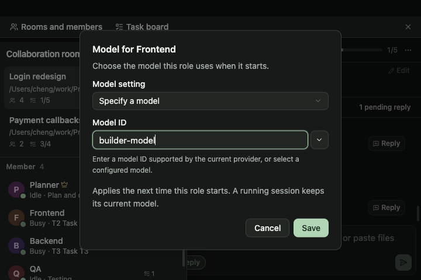

# 按角色设置模型

在协作房间的成员菜单中选择「设置角色模型」。可以沿用默认，也可以输入当前供应商支持的模型标识，或从已配置的模型中选择。单独指定后，成员列表会显示模型名称。



设置用于这个角色下一次创建 Agent 进程。保存设置不会重启正在运行的会话；重新连接仍在运行的后台进程也不会改变其模型。选择「沿用默认」会清除角色覆盖，继续使用项目 Provider 的模型；未设置项目 Provider 时沿用 Agent 的全局配置。

## 持久化与启动

- `Member.modelOverride` 保存角色覆盖，旧成员缺少字段时默认继承。空白模型不等同清除，清除明确使用 `null`。
- `room_set_member_model` 校验成员仍在场，并比较表单打开时的 tab、Agent 类型和原模型，避免迟到保存覆盖新设置。保存失败保留原设置，不新增聊天、任务或投递记录。
- 真正创建进程时，通过稳定 tab 与规范化项目路径查询角色配置；同类 Agent 的不同角色可以分别使用不同模型。已离开的成员或其他项目的设置不参与选择。
- 同一项目中多间房共用同一条会话时，不能为其中某个角色指定独立模型。已设置覆盖后又共用会话的，启动会明确报错；清除覆盖始终可用。
- 支持 Codex、Claude Code、Pi、Antigravity CLI、OpenCode 和 Kimi Code。项目/全局 Provider 的凭据及保存的模型不被改写。需要模型映射的 Agent 在本次启动副本中使用角色模型；CLI 自行管理登录时只加本次模型参数。
- 指定角色模型时使用明确的模型启动参数，继续已有历史也传递该选择。Kimi 和 Antigravity 保留自身的模型别名映射；Pi、OpenCode 使用本次 Provider 副本中的模型。
- 与协作收件箱的存储格式升级一同整合，旧写者保护由 T62 的 RoomStore 版本迁移负责。

## 验证

使用临时 RoomStore 和启动配置目录，不操作用户会话存储或调用模型服务。

- 角色存储 9 项：旧数据、保存/重载/清除、角色与项目隔离、陈旧表单、共享会话、Agent 不匹配、路径别名、非法标识和写盘失败。
- 整合收件箱后的房间 Rust 回归共 68 项通过，另 2 项为原有显式启动基准。
- Provider 启动相关 12 项通过；新增覆盖六种 Agent 的模型映射、原 Provider 不变、默认继承和 CLI 模型参数。原有真实 CLI 网络冒烟用例继续按仓库设置忽略。
- 房间读取/结构共享 12 项通过。
- 浏览器 3 个组合流程：1440×900 中文和 720×480 英文，模型候选选择、两个角色分别保存、清除覆盖、保存不启动进程、失败保留输入、轮询后的陈旧保存和角色改绑关闭表单。
- TypeScript、生产构建、国际化词条与生成目录检查。

运行浏览器回归：

```sh
node --experimental-websocket --test src/components/lazy/testing/room-role-model.case.mjs
```

Node 20 需要上述 WebSocket 标记。浏览器验证运行真实 React 页面并替换原生 IPC；Rust 验证实际存储与启动配置生成。本机验证为 macOS，未执行 Windows 原生进程验收。
